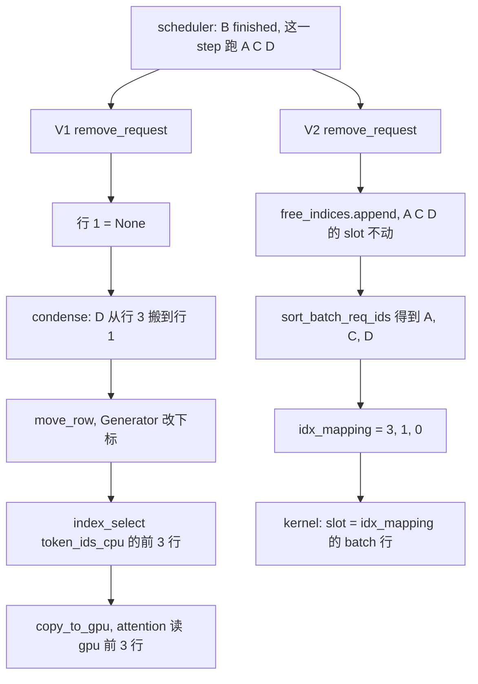
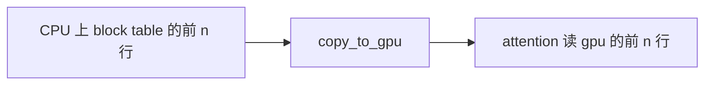
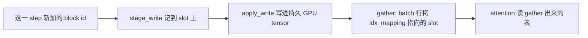
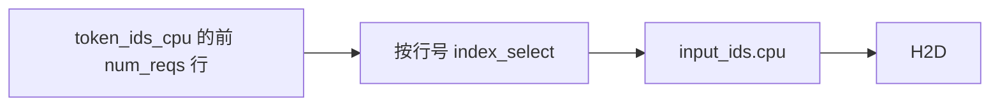
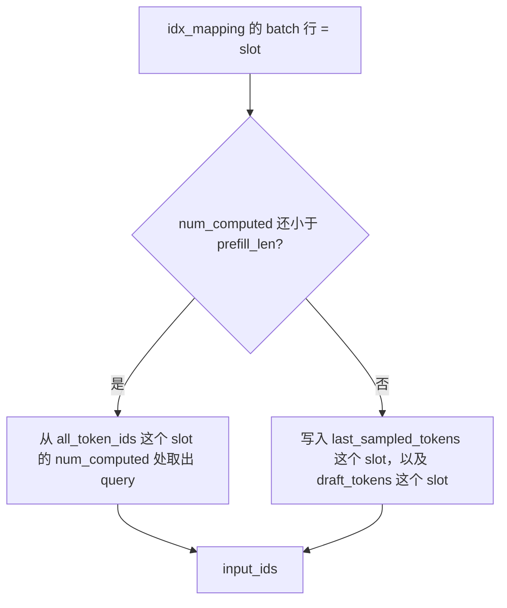

# Persistent batch 和 input preparation

代码版本：[vLLM `e80b6c6`](https://github.com/vllm-project/vllm/commit/e80b6c642f21fd5b24439825592f5b9ced36add8)。

Persistent batch 是跨 step 保存的请求状态。V1 把这批 tensor 直接当作这一 step 的 model input，所以 row 必须紧凑、顺序必须对。V2 把两件事拆开：`RequestState` 里每个 request 占一个固定 slot；这一 step 的 model input 是另组的 `InputBatch`，用 `idx_mapping` 从 slot 里 gather 出来。

## 为什么 V1 要 `condense`

Attention 读的就是 persistent batch 里 block table 的前 `num_reqs` 行。中间一个 request 结束，这一行空了，后面的 request 还停在原下标，和 model input 对不上。所以要把后面的 row 往前挪。

[`remove_request`](https://github.com/vllm-project/vllm/blob/e80b6c642f21fd5b24439825592f5b9ced36add8/vllm/v1/worker/gpu_input_batch.py#L523-L532) 的 docstring 要求调用后必须再调 `condense()`。[`condense`](https://github.com/vllm-project/vllm/blob/e80b6c642f21fd5b24439825592f5b9ced36add8/vllm/v1/worker/gpu_input_batch.py#L698-L730) 做的事：从高位找非空 request，填进低位的空槽。跟着搬的有：

- [`swap_states`](https://github.com/vllm-project/vllm/blob/e80b6c642f21fd5b24439825592f5b9ced36add8/vllm/v1/worker/gpu_input_batch.py#L580-L587)：交换两个下标上的 token 前缀
- 同一次 `condense` 里把 `generators[旧下标]` 改挂到新下标（[第 809–811 行](https://github.com/vllm-project/vllm/blob/e80b6c642f21fd5b24439825592f5b9ced36add8/vllm/v1/worker/gpu_input_batch.py#L809-L811)）
- [`BlockTable.move_row`](https://github.com/vllm-project/vllm/blob/e80b6c642f21fd5b24439825592f5b9ced36add8/vllm/v1/worker/block_table.py#L137-L146)：在 numpy 上把一行 block id 拷到目标 row，源 row 清零

Row 会被别的 request 盖掉，所以 V1 另存一份 [`CachedRequestState`](https://github.com/vllm-project/vllm/blob/e80b6c642f21fd5b24439825592f5b9ced36add8/vllm/v1/worker/gpu_input_batch.py#L35-L74)。

## 四个请求走一遍

`max_num_reqs = 4`。A、B、C、D 都在 batch 里，这一 step B 结束，还要跑 A、C、D。三步都是同样长度的 decode，没有 draft token。

V1 的 `add_request` 从低位空槽往上填，所以开始时行号就是加入顺序。V2 的 `free_indices` 初始是 `[0, 1, 2, 3]`，`pop()` 从尾部拿，所以 A 拿到 slot 3，B 拿到 2，C 拿到 1，D 拿到 0。

| 请求 | V1 开始 | V1 `condense` 之后 | V2 slot | V2 这一 step gather |
|------|---------|-------------------|---------|---------------------|
| A | 行 0 | 行 0 | slot 3 | batch 0 ← slot 3 |
| B | 行 1 | 删除 | slot 2 还回 `free_indices` | 不在这一 step |
| C | 行 2 | 行 2 | slot 1 | batch 1 ← slot 1 |
| D | 行 3 | 行 1 | slot 0 | batch 2 ← slot 0 |

V1 这一 step 读到的三行是 A、D、C。D 从行 3 搬到行 1，token、temperature、`Generator`、block table 跟着行号走。V2 的 slot 不动，batch 顺序只写在 `idx_mapping = [3, 1, 0]` 里。



### V1：挖洞，再把行搬紧

[`remove_request`](https://github.com/vllm-project/vllm/blob/e80b6c642f21fd5b24439825592f5b9ced36add8/vllm/v1/worker/gpu_input_batch.py#L523-L541) 只把这一行标空：

```python
def remove_request(self, req_id: str) -> int | None:
    """This method must always be followed by a call to condense()."""
    req_index = self.req_id_to_index.pop(req_id, None)
    if req_index is None:
        return None
    self.batch_update_builder.removed_append(req_index)
    self._req_ids[req_index] = None
    self.block_table.clear_row(req_index)
```

[`_update_states`](https://github.com/vllm-project/vllm/blob/e80b6c642f21fd5b24439825592f5b9ced36add8/vllm/v1/worker/gpu_model_runner.py#L1191-L1487) 对 finished 和这一 step 没排上的请求都调它，新请求先填低位空槽，最后 `self.input_batch.condense()`。

这个例子里 `num_reqs` 还剩 3，空槽是行 1，`last_req_index` 算出来是 3。[`condense`](https://github.com/vllm-project/vllm/blob/e80b6c642f21fd5b24439825592f5b9ced36add8/vllm/v1/worker/gpu_input_batch.py#L722-L811) 把 D 搬下去：

```python
last_req_index = num_reqs + len(empty_req_indices) - 1
empty_index = self.batch_update_builder.peek_removed()
req_id = self._req_ids[last_req_index]
self._req_ids[empty_index] = req_id
self._req_ids[last_req_index] = None
self.req_id_to_index[req_id] = empty_index
self.token_ids_cpu[empty_index, :num_tokens] = self.token_ids_cpu[
    last_req_index, :num_tokens
]
self.block_table.move_row(last_req_index, empty_index)
generator = self.generators.pop(last_req_index, None)
if generator is not None:
    self.generators[empty_index] = generator
```

[`move_row`](https://github.com/vllm-project/vllm/blob/e80b6c642f21fd5b24439825592f5b9ced36add8/vllm/v1/worker/block_table.py#L137-L146) 在 numpy 上把一整行 block id 拷到目标行，源行清零。

搬完后，[`_prepare_inputs`](https://github.com/vllm-project/vllm/blob/e80b6c642f21fd5b24439825592f5b9ced36add8/vllm/v1/worker/gpu_model_runner.py#L1930-L1975) 用行号 `0 .. num_reqs-1` 当模型输入。`req_indices` 是把每个请求的行号按这一 step 的 token 数重复，再去 `token_ids_cpu` 里取：

```python
num_reqs = self.input_batch.num_reqs
self.input_batch.block_table.commit_block_table(num_reqs)
req_indices = np.repeat(self.arange_np[:num_reqs], num_scheduled_tokens)
token_indices = positions_np + req_indices * self.input_batch.token_ids_cpu.shape[1]
torch.index_select(
    self.input_batch.token_ids_cpu_tensor.flatten(),
    0,
    token_indices_tensor,
    out=self.input_ids.cpu[:total_num_scheduled_tokens],
)
```

[`commit_block_table`](https://github.com/vllm-project/vllm/blob/e80b6c642f21fd5b24439825592f5b9ced36add8/vllm/v1/worker/block_table.py#L181-L190) 把前 `num_reqs` 行拷上 GPU。Attention 读 `gpu[:num_reqs]`。行没压紧的话，中间的空行会进模型。

### V2：slot 不动，`idx_mapping` 指出这一 step 读哪一行

[`add_request` / `remove_request`](https://github.com/vllm-project/vllm/blob/e80b6c642f21fd5b24439825592f5b9ced36add8/vllm/v1/worker/gpu/states.py#L91-L134)：

```python
req_idx = self.free_indices.pop()
self.req_id_to_index[req_id] = req_idx
self.index_to_req_id[req_idx] = req_id

req_idx = self.req_id_to_index.pop(req_id, None)
self.index_to_req_id.pop(req_idx, None)
self.free_indices.append(req_idx)
```

没有 `condense`，也没有 `CachedRequestState`。Preempt 和正常结束走同一条删除。[`finish_requests`](https://github.com/vllm-project/vllm/blob/e80b6c642f21fd5b24439825592f5b9ced36add8/vllm/v1/worker/gpu/model_runner.py#L1165-L1176) 把 `preempted_req_ids` 并进 `finished_req_ids`。再次调度时重新 `add_request`，拿到的是当时 `free_indices` 里的空 slot，可以不是上次那个。

这一 step 的顺序在 [`gather_batch_req_state`](https://github.com/vllm-project/vllm/blob/e80b6c642f21fd5b24439825592f5b9ced36add8/vllm/v1/worker/gpu/model_runner.py#L1302-L1312) 里排。它排 req id，不改 `RequestState`：

```python
req_ids = sort_batch_req_ids(
    num_tokens_per_req, draft_tokens, self.decode_query_len
)
idx_mapping_np = np.fromiter(
    map(self.req_states.req_id_to_index.__getitem__, req_ids),
    dtype=np.intp,
    count=num_reqs,
)
```

[`sort_batch_req_ids`](https://github.com/vllm-project/vllm/blob/e80b6c642f21fd5b24439825592f5b9ced36add8/vllm/v1/worker/gpu/model_runner.py#L2456-L2468) 把带 draft token 的放前面，再把 query 长度等于 `decode_query_len` 的放前面，最后按 token 数。这个例子里 A、C、D 的 key 相同，顺序保持 scheduler 给出的 A、C、D，所以 `idx_mapping` 是 `[3, 1, 0]`。

`idx_mapping[batch 下标] = slot`。后面的 block table 和 `input_ids` 都用它从 slot 取数据。

## 状态怎么写到 GPU

V1 的 persistent batch 前 n 行就是 attention 要读的行，所以每 step 把这 n 行整段拷上 GPU，不管这一 step 实际改了几格。



[`CpuGpuBuffer.copy_to_gpu`](https://github.com/vllm-project/vllm/blob/e80b6c642f21fd5b24439825592f5b9ced36add8/vllm/v1/utils.py#L139-L143) 和 block table 的提交：

```python
def copy_to_gpu(self, n: int | None = None) -> torch.Tensor:
    cpu, gpu = self.cpu, self.gpu
    if n is not None:
        cpu, gpu = cpu[:n], gpu[:n]
    return gpu.copy_(cpu.pin_memory() if PIN_MEMORY else cpu, non_blocking=True)

def commit_block_table(self, num_reqs: int) -> None:
    self.block_table.copy_to_gpu(num_reqs)

def get_device_tensor(self, num_reqs: int) -> torch.Tensor:
    return self.block_table.gpu[:num_reqs]
```

V2 的 block table 按 slot 放在一张持久 GPU tensor 上。这一 step 只把新加的 block id 写进对应 slot，再按 `idx_mapping` 抄出这一 step 的表。没改的 slot 不动。



[`append_block_ids`](https://github.com/vllm-project/vllm/blob/e80b6c642f21fd5b24439825592f5b9ced36add8/vllm/v1/worker/gpu/block_table.py#L111-L130) 对每个 KV cache group 调 `stage_write(slot, start, block_ids)`，只记下新加的那段。[`apply_staged_writes`](https://github.com/vllm-project/vllm/blob/e80b6c642f21fd5b24439825592f5b9ced36add8/vllm/v1/worker/gpu/block_table.py#L132-L144) 一个 group 时调 `apply_write()`，多个 group 用 `FusedStagedWriter` 一次 kernel 写完。`apply_write` 把暂存的行号、起点、内容打成三段，拷上 GPU，再写回持久 tensor（[`buffer_utils.py`](https://github.com/vllm-project/vllm/blob/e80b6c642f21fd5b24439825592f5b9ced36add8/vllm/v1/worker/gpu/buffer_utils.py#L196-L211)）。

Attention 不读这张持久 tensor。[`_gather_block_tables_kernel`](https://github.com/vllm-project/vllm/blob/e80b6c642f21fd5b24439825592f5b9ced36add8/vllm/v1/worker/gpu/block_table.py#L251-L276) 里，`batch_idx` 是输出行，`req_idx` 才是 slot。上面的例子里 batch 0 拷 slot 3（A），batch 1 拷 slot 1（C），batch 2 拷 slot 0（D）：

```python
dst_row_ptr = dst_block_table_ptr + batch_idx * stride
req_idx = tl.load(batch_idx_to_req_idx + batch_idx)
src_row_ptr = src_block_table_ptr + req_idx * stride
block_ids = tl.load(src_row_ptr + offset, mask=offset < num_blocks)
tl.store(dst_row_ptr + offset, block_ids, mask=offset < num_blocks)
```

长度类的状态走另一条路。`prompt_len`、`prefill_len` 是 [`UvaBackedTensor`](https://github.com/vllm-project/vllm/blob/e80b6c642f21fd5b24439825592f5b9ced36add8/vllm/v1/worker/gpu/buffer_utils.py#L109-L124)：CPU 那份 `pin_memory=False`，每 step `copy_to_uva` 进 pool 的下一块 pinned buffer，GPU 读那一块。Pool 的槽数是 `max_concurrent_batches`，再和 2 取最大；V2 打开 async scheduling 时这个值等于 `pp_size + 1`（[`vllm.py`](https://github.com/vllm-project/vllm/blob/e80b6c642f21fd5b24439825592f5b9ced36add8/vllm/config/vllm.py#L578-L588)、[`buffer_utils.py`](https://github.com/vllm-project/vllm/blob/e80b6c642f21fd5b24439825592f5b9ced36add8/vllm/v1/worker/gpu/buffer_utils.py#L24-L26)）。`prompt_len` 是用户 prompt 的 token 数，`prefill_len` 是送进 model runner 的 token 数，preempt 恢复时可以带上已经生成、需要重算的 token，所以 `prefill_len >= prompt_len`。`all_token_ids` 默认让 GPU kernel 直接读 CPU 内存，不每 step 整表 H2D（[`states.py`](https://github.com/vllm-project/vllm/blob/e80b6c642f21fd5b24439825592f5b9ced36add8/vllm/v1/worker/gpu/states.py#L37-L51)）。

## 这一 step 的 `input_ids` 从哪来

V1 在 CPU 上从 persistent batch 的前 `num_reqs` 行把 token 拼出来，再 H2D。Async scheduling 下，上一步 sample 出的 token 还在 GPU 上，要先回到 CPU 才能拼进下一步。



拼的位置就是上面 `_prepare_inputs` 里的 `index_select`。回到 CPU 的函数是 [`update_async_output_token_ids`](https://github.com/vllm-project/vllm/blob/e80b6c642f21fd5b24439825592f5b9ced36add8/vllm/v1/worker/gpu_input_batch.py#L1038-L1042)：等 sampled token 拷完，写进 `sampling_metadata.output_token_ids`。

V2 不在 CPU 上拼 token。`prepare_inputs` 先把 `idx_mapping` H2D，kernel 用 batch 下标查出 slot，再从 slot 上取。



Prefill，[`_prepare_prefill_inputs_kernel`](https://github.com/vllm-project/vllm/blob/e80b6c642f21fd5b24439825592f5b9ced36add8/vllm/v1/worker/gpu/input_batch.py#L286-L302)。`num_computed >= prefill_len` 就直接返回，这条请求交给 decode 那段：

```python
batch_idx = tl.program_id(0)
req_state_idx = tl.load(idx_mapping_ptr + batch_idx)
request_ptr = all_token_ids_ptr + req_state_idx * all_token_ids_stride
tokens = tl.load(request_ptr + num_computed + block, mask=mask)
tl.store(input_ids_ptr + query_start + block, tokens, mask=mask)
```

Decode，[`_combine_sampled_and_draft_tokens_kernel`](https://github.com/vllm-project/vllm/blob/e80b6c642f21fd5b24439825592f5b9ced36add8/vllm/v1/worker/gpu/input_batch.py#L421-L452)。`seq_len <= prefill_len` 说明还在 prefill，这里不写。否则把该 slot 上一步 sample 出的 token 写到这条 logits 的起点，draft token 写到末尾：

```python
req_state_idx = tl.load(idx_mapping_ptr + batch_idx)
if seq_len <= prefill_len:
    return
last_token_id = tl.load(last_sampled_tokens_ptr + req_state_idx)
tl.store(input_ids_ptr + logits_start, last_token_id)
```

`last_sampled_tokens` 和 `draft_tokens` 都在 GPU 上。CPU 不读这两个 tensor。

`query_start_loc` 的前缀和仍在 [`prepare_inputs`](https://github.com/vllm-project/vllm/blob/e80b6c642f21fd5b24439825592f5b9ced36add8/vllm/v1/worker/gpu/model_runner.py#L1438-L1448) 里用 numpy 算。选 CUDA graph 在这些 kernel 之前，CPU 需要这个前缀和。
