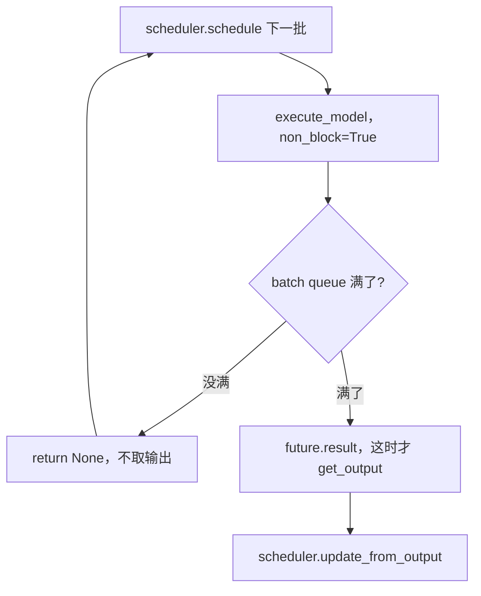
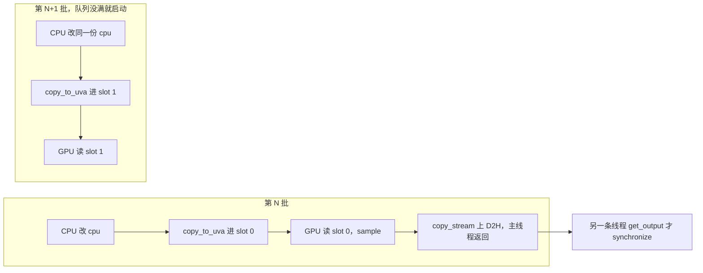
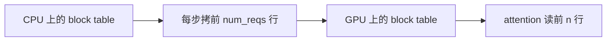
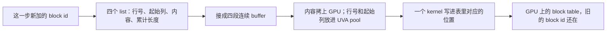

# Async scheduling

代码版本：[vLLM `e80b6c6`](https://github.com/vllm-project/vllm/commit/e80b6c642f21fd5b24439825592f5b9ced36add8)。代码块里的中文注释是加上的，上游源码里没有。

异步调度要的是：这一批 GPU 还在算，CPU 已经把下一批排进去。`step_with_batch_queue` 里队列没满就 `schedule`，再 `execute_model(non_block=True)`，然后 `return None`。这一步不取模型输出。队列满了才 `future.result()`，那时才等到上一批的结果。

下一批因此会在上一批还没算完时进入 worker。要接住它，下一批写的内存不能是上一批 GPU 正在读的那块，worker 主线程也不能停下来等 D2H。



## 队列没满就先排下一批

[`step_with_batch_queue`](https://github.com/vllm-project/vllm/blob/e80b6c642f21fd5b24439825592f5b9ced36add8/vllm/v1/engine/core.py#L698-L773)：

```python
def step_with_batch_queue(self):
    """Schedule and execute batches with the batch queue.
    1. Try to schedule a new batch if the batch queue is not full.
    If a new batch is scheduled, directly return an empty engine core
    output. In other words, fulfilling the batch queue has a higher priority
    than getting model outputs.
    # 队列没满时，填队列比取模型输出优先。
    2. If there is no new scheduled batch, meaning that the batch queue
    is full or no other requests can be scheduled, we block until the first
    batch in the job queue is finished.
    3. Update the scheduler from the output.
    """
    batch_queue = self.batch_queue
    assert batch_queue is not None
    assert len(batch_queue) < self.batch_queue_size

    model_executed = False
    deferred_scheduler_output = None
    if self.scheduler.has_requests():
        scheduler_output = self.scheduler.schedule(self._should_throttle_prefills())
        with self.log_error_detail(scheduler_output):
            exec_future = self.model_executor.execute_model(
                scheduler_output, non_block=True
            )
        # 把这一批交给 worker 后不等结果。
        if not self.is_mm_encoder_only:
            model_executed = scheduler_output.total_num_scheduled_tokens > 0

        if self.is_pooling_model or not model_executed:
            future = cast(Future[ModelRunnerOutput], exec_future)
        else:
            if not scheduler_output.pending_structured_output_tokens:
                grammar_output = self.scheduler.get_grammar_bitmask(scheduler_output)
                future = self.model_executor.sample_tokens(
                    grammar_output, non_block=True
                )
            else:
                # 还要等上一批的 token 才能 sample。这批先不放进队列。
                deferred_scheduler_output = scheduler_output

        if not deferred_scheduler_output:
            batch_queue.appendleft((future, scheduler_output, exec_future))
            if len(batch_queue) < self.batch_queue_size and (
                model_executed or self.scheduler.has_requests()
            ):
                # 队列还没满，直接返回。这里不调用 future.result()。
                return None, model_executed

    # 队列满了，或者没有请求可排。
    future, scheduler_output, exec_model_fut = batch_queue.pop()
    model_output = future.result()
    # 这里才进到 get_output()，等到上一批的结果。
```

队列长度就是同时能在飞的批次数。[`core.py`](https://github.com/vllm-project/vllm/blob/e80b6c642f21fd5b24439825592f5b9ced36add8/vllm/v1/engine/core.py#L220) 把 `batch_queue_size` 设成 `max_concurrent_batches`。[`vllm.py`](https://github.com/vllm-project/vllm/blob/e80b6c642f21fd5b24439825592f5b9ced36add8/vllm/config/vllm.py#L578-L588)：

```python
self.batch_queue_size = vllm_config.max_concurrent_batches

def max_concurrent_batches(self) -> int:
    pp_size = self.parallel_config.pipeline_parallel_size
    if self.scheduler_config.async_scheduling:
        if self.use_v2_model_runner:
            return pp_size + 1
            # async scheduling 且走 V2。pp_size == 1 时就是 2，能重叠两批。
        if pp_size <= 1:
            return 2
            # 同一配置下 V1 只有 pp_size <= 1 才是 2。
    return pp_size
```

[`GPUModelRunner.__init__`](https://github.com/vllm-project/vllm/blob/e80b6c642f21fd5b24439825592f5b9ced36add8/vllm/v1/worker/gpu/model_runner.py#L242) 把这个数交给 pool。[`set_default_max_concurrency`](https://github.com/vllm-project/vllm/blob/e80b6c642f21fd5b24439825592f5b9ced36add8/vllm/v1/worker/gpu/buffer_utils.py#L24-L26) 再和 2 取最大。async scheduling 且 V2 时 `pp_size + 1` 已经不小于 2，所以 pool 的槽数就等于 `batch_queue_size`。

```python
set_default_max_concurrency(vllm_config.max_concurrent_batches)

def set_default_max_concurrency(n: int) -> None:
    global _DEFAULT_MAX_CONCURRENCY
    _DEFAULT_MAX_CONCURRENCY = max(2, n)
    # 槽数至少 2。V2 开 async 时 n = pp_size + 1，和队列长度相同。
```

这个数是在飞的批次数，不是这一步里有多少个 request。

## V1 还是要等

下一批已经排进来了，worker 里改 persistent batch 之前先停住。[`execute_model`](https://github.com/vllm-project/vllm/blob/e80b6c642f21fd5b24439825592f5b9ced36add8/vllm/v1/worker/gpu_model_runner.py#L3969-L3974) 用 `synchronize_input_prep` 包住 `_update_states`。[`synchronize_input_prep`](https://github.com/vllm-project/vllm/blob/e80b6c642f21fd5b24439825592f5b9ced36add8/vllm/v1/worker/gpu_model_runner.py#L3601-L3613)：

```python
with self.synchronize_input_prep():
    # Update persistent batch states.
    deferred_state_corrections_fn = self._update_states(scheduler_output)

@contextmanager
def synchronize_input_prep(self):
    if self.prepare_inputs_event is None:
        yield
        return
    # 上一批的 H2D 是异步的，CPU 和 GPU 共用这块 pinned tensor。
    self.prepare_inputs_event.synchronize()
    # 下一批已经进了 worker。改 persistent batch 之前，主线程在这里等上一批的拷贝结束。
    try:
        yield
        # yield 后面才跑 _update_states，改的就是上一批还在读的那块内存。
    finally:
        self.prepare_inputs_event.record()
```

V1 的 `CpuGpuBuffer` 只有一块 pinned 的 `cpu`。`copy_to_gpu` 用 `non_blocking=True` 从这块往 GPU 拷。下一批要写同一块时，上一批的拷贝可能还没结束，所以必须先 `synchronize()`。

输出也停在主线程上。[`_to_list`](https://github.com/vllm-project/vllm/blob/e80b6c642f21fd5b24439825592f5b9ced36add8/vllm/v1/worker/gpu_model_runner.py#L7149-L7162)：

```python
def _to_list(self, sampled_token_ids):
    pinned = self.sampled_token_ids_pinned_cpu[: sampled_token_ids.shape[0]]
    pinned.copy_(sampled_token_ids, non_blocking=True)
    self.transfer_event.record()
    self.transfer_event.synchronize()
    # sample 一结束就在 worker 主线程上等。execute_model 还不返回，下一批进不来。
    return pinned.tolist()
```

## V2 的 pool

CPU 这边以前只有一块 pinned 内存。V2 的 `UvaBufferPool` 按在飞的批次数分槽。CPU 仍有一份不 pin 的 `cpu`，每一步都改它。`copy_to_uva` 再把这份内容拷进 pool 的下一块。GPU 通过 UVA 读的是 pool 里的那一块，不是 `cpu`。下一批写下一块，上一批还在读的那块不会被盖掉，所以这里没有 `synchronize_input_prep`。

[`buffer_utils.py`](https://github.com/vllm-project/vllm/blob/e80b6c642f21fd5b24439825592f5b9ced36add8/vllm/v1/worker/gpu/buffer_utils.py#L85-L129)：

```python
def copy_to_uva(self, x):
    # Round robin to the next buffer.
    self._curr = (self._curr + 1) % self.max_concurrency
    # 每次换 pool 里的下一块。槽数等于 batch_queue_size。
    buf = self._uva_bufs[self._curr]
    n = len(x)
    if n > buf.cpu.shape[0]:
        capacity = 1 << (n - 1).bit_length()
        buf = self._buffer_cls((capacity, *buf.cpu.shape[1:]), self.dtype)
        self._uva_bufs[self._curr] = buf
    # CPU-to-CPU copy
    dst = buf.cpu if isinstance(x, torch.Tensor) else buf.np
    dst[:n] = x
    # 写进这一块 pinned 内存。源是不 pin 的那份 cpu。
    return buf.uva(n)
    # 返回这块内存的设备指针。GPU 接下来读它，不是去读 self.cpu。

class UvaBackedTensor:
    def __init__(...):
        # Source of truth
        self.cpu = torch.zeros(size, dtype=dtype, device="cpu", pin_memory=False)
        self.np = self.cpu.numpy()
        # 不 pin。CPU 接着改的是这份。
        self.pool = UvaBufferPool(size, dtype, max_concurrency)
        self.gpu = self.pool.copy_to_uva(self.np)

    def copy_to_uva(self, n=None):
        # CPU-to-CPU copy
        self.gpu = self.pool.copy_to_uva(self.np[:n] if n is not None else self.np)
        return self.gpu
        # 下一批再调用时 _curr 已经加一，self.gpu 指向另一块。
```

`prompt_len`、`prefill_len` 走这条路。GPU 上没有再分配一块来接收它们。`self.gpu` 是 `cudaHostGetDevicePointer` 得到的设备指针，底下还是 pool 里那块主机内存。kernel 读它时走 PCIe，数据不进显存。

队列没满才会再塞一批，槽数又和队列长度一样。轮转回到某一块时，最老的那一批已经 `get_output()` 过了，没有 kernel 还在读它。

两批叠在一起：



block table 用的 `StagedWriteTensor` 是另一条路，GPU 上有一块一直留着的 tensor。CPU 只把这一 step 新加的 block id 记下来，`apply_write` 用 kernel 写进对应行。细节在 [persistent batch](02-persistent-batch.md)。

## D2H 不在主线程等

[`AsyncOutput.__init__`](https://github.com/vllm-project/vllm/blob/e80b6c642f21fd5b24439825592f5b9ced36add8/vllm/v1/worker/gpu/async_utils.py#L137-L174) 把拷贝发到 `copy_stream`，`record` 之后就返回。[`get_output`](https://github.com/vllm-project/vllm/blob/e80b6c642f21fd5b24439825592f5b9ced36add8/vllm/v1/worker/gpu/async_utils.py#L173-L180) 才 `synchronize()`。

```python
with stream(copy_stream, main_stream):
    copy_stream.wait_stream(main_stream)
    # 等 main stream 上的 sample 写完这些 tensor，再在 copy_stream 上拷。
    self.sampled_token_ids = async_copy_to_np(sampler_output.sampled_token_ids)
    self.num_sampled_tokens_np = async_copy_to_np(num_sampled_tokens)
    self.copy_event.record(copy_stream)
    # 主线程到这里就返回，不 synchronize。

def get_output(self):
    self.copy_event.synchronize()
    # 谁来取结果，谁才在这里等 D2H。
    sampled_token_ids = self.sampled_token_ids.tolist()
```

async scheduling 时，这次等待在另一条线程上。[`handle_output`](https://github.com/vllm-project/vllm/blob/e80b6c642f21fd5b24439825592f5b9ced36add8/vllm/v1/executor/multiproc_executor.py#L991-L1035) 只入队。`async_output_busy_loop` 里调用 `enqueue_output`，那里才 `get_output()`。worker 主线程回去执行 engine 已经排进来的下一批。

```python
def enqueue_output(self, output):
    if isinstance(output, AsyncModelRunnerOutput):
        output = output.get_output()
        # synchronize() 发生在这次调用里。

def handle_output(self, output):
    if self.use_async_scheduling:
        self.async_output_queue.put(output)
        # 主线程只入队，不调用 get_output()。
    else:
        self.enqueue_output(output)

def async_output_busy_loop(self):
    while True:
        output = self.async_output_queue.get()
        self.enqueue_output(output)
        # 这条线程取结果。主线程可以去跑下一批。
```

下一批拼 `input_ids` 也不用等这次 D2H。上一步 sample 出的 token 在 GPU 的 `last_sampled_tokens` 里，kernel 按 slot 读。见 [persistent batch](02-persistent-batch.md)。

## Staged write tensor

### V1

V1 的 block table 有两份，一份在 CPU，一份在 GPU。CPU 那份用 numpy 改。每一步把 CPU 上前 `num_reqs` 行整段复制到 GPU，attention 读 GPU 上的这前 n 行。这一步只改了几个格子，没改的行也会再拷一遍。

[`commit_block_table`](https://github.com/vllm-project/vllm/blob/e80b6c642f21fd5b24439825592f5b9ced36add8/vllm/v1/worker/block_table.py#L181-L190) 和 [`copy_to_gpu`](https://github.com/vllm-project/vllm/blob/e80b6c642f21fd5b24439825592f5b9ced36add8/vllm/v1/utils.py#L139-L143)：

```python
def commit_block_table(self, num_reqs: int) -> None:
    self.block_table.copy_to_gpu(num_reqs)
    # 这一步只追加了几个 block id，仍然把前 num_reqs 行整段拷上 GPU。

def get_device_tensor(self, num_reqs: int) -> torch.Tensor:
    return self.block_table.gpu[:num_reqs]
    # attention 读 GPU 上的这前 n 行。

def copy_to_gpu(self, n=None):
    cpu, gpu = self.cpu, self.gpu
    if n is not None:
        cpu, gpu = cpu[:n], gpu[:n]
    return gpu.copy_(cpu.pin_memory() if PIN_MEMORY else cpu, non_blocking=True)
    # cpu 是 CPU 上的整张表，gpu 是 GPU 上的整张表。这里拷的是前 n 行。
```



### V2

V2 的 block table 只放在 GPU 上，CPU 不留整张表。这一步新加的 block id 先记在四个 Python list 里，再由一个 kernel 写进 GPU 那张表的对应位置。旧的 block id 还在原处，不会被整表覆盖。这个函数里没有 `synchronize()`。

[`StagedWriteTensor`](https://github.com/vllm-project/vllm/blob/e80b6c642f21fd5b24439825592f5b9ced36add8/vllm/v1/worker/gpu/buffer_utils.py#L156-L227)。block table 创建时 `uva_instead_of_gpu=False`，所以这张表在 GPU 上：

```python
self.gpu = torch.zeros(size, dtype=dtype, device=device)
# GPU 上的 block table。创建之后一直用这一张。

def stage_write(self, index, start, x):
    if not x:
        return
    self._staged_write_indices.append(index)
    self._staged_write_starts.append(start)
    self._staged_write_contents.extend(x)
    self._staged_write_cu_lens.append(len(self._staged_write_contents))
    # 先记在 CPU 的 list 里。index 是第几行，start 是从这一行的第几列开始写，x 是要写进去的 block id。
```

`stage_write(2, 3, [3, 1, 2])` 再 `stage_write(0, 1, [-1, -2, -5])` 之后，四个 list 是：

| list | 内容 | 含义 |
|------|------|------|
| `_staged_write_indices` | `[2, 0]` | 写第 2 行、第 0 行 |
| `_staged_write_starts` | `[3, 1]` | 从第 3 列、第 1 列开始 |
| `_staged_write_contents` | `[3, 1, 2, -1, -2, -5]` | 要写的 block id，两笔接在一起 |
| `_staged_write_cu_lens` | `[3, 6]` | 第一笔是 `contents[0:3]`，第二笔是 `contents[3:6]` |

```python
def apply_write(self):
    n = len(self._staged_write_indices)
    if n == 0:
        return
    indices_uva = self.write_indices.copy_to_uva(self._staged_write_indices)
    starts_uva = self.write_starts.copy_to_uva(self._staged_write_starts)
    cu_lens_uva = self.write_cu_lens.copy_to_uva(self._staged_write_cu_lens)
    # 行号、起始列、累计长度放到 pool 的下一块，kernel 从这里读。
    write_contents = async_tensor_h2d(
        self._staged_write_contents, device=self.device, dtype=self.dtype
    )
    # 只有这些新的 block id 被拷上 GPU。
    _apply_write_kernel[(n,)](
        self.gpu, self.gpu.stride(0),
        indices_uva, starts_uva, write_contents, cu_lens_uva,
        None, BLOCK_SIZE=1024, MULTI_GROUP=False,
    )
    # n 是笔数。一个 program 写一笔，写完四个 list 就清空。
    self.clear_staged_writes()
```

[`_apply_write_kernel`](https://github.com/vllm-project/vllm/blob/e80b6c642f21fd5b24439825592f5b9ced36add8/vllm/v1/worker/gpu/buffer_utils.py#L312-L335) 算出这一笔在表里的位置，把 block id 写进去：

```python
pid = tl.program_id(0)
row_idx = tl.load(write_indices_ptr + pid)
start_idx = tl.load(write_starts_ptr + pid)
cu_start = tl.load(write_cu_lens_ptr + pid - 1) if pid > 0 else 0
cu_end = tl.load(write_cu_lens_ptr + pid)
row_ptr = output_ptr + row_idx * row_stride + start_idx
content = tl.load(write_contents_ptr + cu_start + block, mask=mask)
tl.store(row_ptr + block, content, mask=mask)
# program 0 往第 2 行第 3 列写 3,1,2。program 1 往第 0 行第 1 列写 -1,-2,-5。
```

block table 在 [`append_block_ids`](https://github.com/vllm-project/vllm/blob/e80b6c642f21fd5b24439825592f5b9ced36add8/vllm/v1/worker/gpu/block_table.py#L111-L144) 里调用 `stage_write`。`start` 是这个 slot 上已经有多少个 block，所以只追加新的。一个 KV group 时调用 `apply_write()`。多个 group 时 `FusedStagedWriter` 把它们合成一次 kernel。`num_computed_tokens` 用 `stage_write_elem(index, x)`，从第 0 列写一个数，后面同样是 `apply_write`。



### 区别

V1 每一步都把前 `num_reqs` 行从 CPU 整段拷到 GPU。V2 的表留在 GPU 上，这一步只把新加的 block id 传过去，一次 kernel 写进对应的格子。CPU 不等这次写完。
