# Sampler

代码版本：[vLLM `e80b6c6`](https://github.com/vllm-project/vllm/commit/e80b6c642f21fd5b24439825592f5b9ced36add8)。

V1 的入口是 [`v1/sample/sampler.py`](https://github.com/vllm-project/vllm/blob/e80b6c642f21fd5b24439825592f5b9ced36add8/vllm/v1/sample/sampler.py)，V2 的入口是 [`v1/worker/gpu/sample/sampler.py`](https://github.com/vllm-project/vllm/blob/e80b6c642f21fd5b24439825592f5b9ced36add8/vllm/v1/worker/gpu/sample/sampler.py)。两边处理 logits 的步骤和顺序大体一样，都是：白名单、bias、min_tokens、penalties、bad words、temperature、min_p、top-k/top-p，最后采样。不一样的是参数怎么存、每一步怎么做。

这一篇先说前提（参数放在 slot 里），然后讲 7 处不同，接着说为什么换成 Triton，最后列出 V2 用到的 Triton 算子。

## 前提：参数放在 slot 里

V1 的参数在 `SamplingMetadata` 里，按"这一步 batch 的第几行"排。batch 里有请求加入、结束，或者 `condense` 搬了行，就要在 CPU 上重新拼一遍再拷到 GPU。

V2 的参数在请求加入时写进它的 slot，之后每一步不再动（[`sample/states.py` L22-L26](https://github.com/vllm-project/vllm/blob/e80b6c642f21fd5b24439825592f5b9ced36add8/vllm/v1/worker/gpu/sample/states.py#L22-L26)）：

```python
# 每个参数一张表，一行一个 slot，大小 max_num_reqs
self.temperature = UvaBackedTensor(max_num_reqs, dtype=torch.float32)
self.top_k = UvaBackedTensor(max_num_reqs, dtype=torch.int32)
self.top_p = UvaBackedTensor(max_num_reqs, dtype=torch.float32)
self.min_p = UvaBackedTensor(max_num_reqs, dtype=torch.float32)
self.seeds = UvaBackedTensor(max_num_reqs, dtype=torch.int64)
```

每一步 CPU 只给出 `expanded_idx_mapping`：每一行 logits 属于哪个 slot。不开 spec decode 时它就等于 `idx_mapping`；开了 spec decode，一个请求有 1 + k 行 logits，就展开成多项：

```
idx_mapping          = [3, 1]           # 按请求
expanded_idx_mapping = [3, 3, 3, 1]     # 按 logits 行：请求 3 有 2 个 draft，占 3 行
```

所有 kernel 开头都是同一个套路，先查 slot 再读参数（[`sample/gumbel.py` L21-L44](https://github.com/vllm-project/vllm/blob/e80b6c642f21fd5b24439825592f5b9ced36add8/vllm/v1/worker/gpu/sample/gumbel.py#L21-L44)）：

```python
@triton.jit
def _temperature_kernel(logits_ptr, logits_stride, expanded_idx_mapping_ptr, temperature_ptr, vocab_size, BLOCK_SIZE):
    token_idx = tl.program_id(0).to(tl.int64)                       # 第几行 logits
    req_state_idx = tl.load(expanded_idx_mapping_ptr + token_idx)   # 这一行属于哪个 slot
    temperature = tl.load(temperature_ptr + req_state_idx).to(tl.float32)
    if temperature == 0.0 or temperature == 1.0:
        # Early return to avoid loading logits.
        return
    ...
    logits = logits / temperature
```

这套机制和 [02-persistent-batch.md](02-persistent-batch.md)、[05-other-features.md](05-other-features.md) 里准备输入用的是同一个：同一个 slot 号，同一个 `idx_mapping`，只是查的表不同。

```mermaid
flowchart TD
    subgraph V1
        A1["batch 变化 → CPU 重建 SamplingMetadata（按 batch 行）"] --> B1["torch 算子 + Python 循环<br/>白名单 / bad words / bias / min_tokens / penalties"]
        B1 --> C1["argmax（greedy）"]
        C1 --> D1["temperature → min_p → top-k/top-p → Generator 噪声 → 随机采样"]
        D1 --> E1["torch.where 合并 greedy 和随机结果"]
    end
    subgraph V2
        A2["请求加入 → 参数写进 slot（只写一次）"] --> B2["_bias_kernel → _penalties_kernel → _bad_words_kernel → _thinking_budget_kernel"]
        B2 --> C2["_temperature_kernel → _min_p_kernel → top-k/top-p"]
        C2 --> D2["_gumbel_sample_kernel<br/>temp=0 直接 argmax，否则哈希噪声 + argmax"]
        D2 --> E2["_get_num_sampled_and_rejected_kernel → _post_update_kernel"]
    end
```



## 7 处不同

### 1. 随机数：不再用 `torch.Generator`，改成哈希

V1 设了 seed 的请求，每个有自己的 `torch.Generator`，要用 Python 循环一个一个生成噪声（[`ops/topk_topp_sampler.py` L601-L613](https://github.com/vllm-project/vllm/blob/e80b6c642f21fd5b24439825592f5b9ced36add8/vllm/v1/sample/ops/topk_topp_sampler.py#L601-L613)）：

```python
q = empty_exponential_noise_like(probs, use_fp64_gumbel)
if len(generators) != probs.shape[0]:
    q.exponential_()                                # 没设 seed 的请求一次生成
if generators:
    # TODO(woosuk): This can be slow because we handle each request
    # one by one. Optimize this.
    for i, generator in generators.items():         # 设了 seed 的逐个生成
        q[i].exponential_(generator=generator)
return sample_with_exponential_noise(probs, q)
```

`torch.Generator` 有内部状态，每用一次就往前走一步。`generators` 的 key 还是 batch 行号，`condense` 搬行时要跟着改。

V2 所有请求都有 seed，没设的在加入时随机给一个（[`sample/states.py` L54-L58](https://github.com/vllm-project/vllm/blob/e80b6c642f21fd5b24439825592f5b9ced36add8/vllm/v1/worker/gpu/sample/states.py#L54-L58)）：

```python
seed = sampling_params.seed
self.seeds_set[req_idx] = seed is not None
if seed is None:
    seed = np.random.randint(_NP_INT64_MIN, _NP_INT64_MAX)
self.seeds.np[req_idx] = seed
```

噪声由 `hash(seed, 位置, token id)` 算出来（[`sample/gumbel.py` L171-L211](https://github.com/vllm-project/vllm/blob/e80b6c642f21fd5b24439825592f5b9ced36add8/vllm/v1/worker/gpu/sample/gumbel.py#L171-L211)）：

```python
def gumbel_noised_argmax(logits, keys, mask, seed, pos, temp, IS_DRAFTING, USE_FP64, APPLY_TEMPERATURE=True):
    """Argmax of logits under Gumbel-max sampling, or plain argmax at temp 0.

    `keys` indexes the noise, so the same token draws the same noise wherever it
    appears; `pos` and `seed` place the draw in the request's stream, which is
    what lets a draft and its verification agree.
    """
    ...
    if temp != 0.0:
        ...
        u = murmur3_uniform32(seed, pos, keys)               # 同一个 seed、位置、token，噪声永远一样
        gumbel_noise = -tl.log(-_log1p_neg_stable(u))
        logits = tl.where(mask, logits + gumbel_noise, float("-inf"))
    return tl.max(logits, axis=0, return_indices=True)       # Gumbel-max：加噪声后取 argmax，等价于按概率采样
```

这样有四个好处：

- 不用 Python 循环，所有请求在一个 kernel 里生成噪声。
- 没有状态，结果和"这个请求跟谁一起组 batch""这是第几次调用"都无关。
- spec decode 里 draft 和 verify 在同一位置用同一份噪声，结果对得上。
- 不碰 CPU 端的状态，可以录进 CUDA graph。

### 2. greedy 和随机采样合在一个 kernel 里

V1 先给所有行都算一次 argmax，再做完整的随机采样，最后按 temperature 挑结果（[`sampler.py` L320-L366](https://github.com/vllm-project/vllm/blob/e80b6c642f21fd5b24439825592f5b9ced36add8/vllm/v1/sample/sampler.py#L320-L366)，节选）：

```python
if sampling_metadata.all_random:
    greedy_sampled = None
else:
    greedy_sampled = self.greedy_sample(logits)       # 不管是不是 greedy 行，先全部 argmax
    if sampling_metadata.all_greedy:
        return greedy_sampled, ...
logits = self.apply_temperature(...)                  # greedy 行的 temperature 先换成 1 再除
...
random_sampled, processed_logprobs = self.topk_topp_sampler(...)   # 所有行都随机采样一次
sampled = torch.where(
    sampling_metadata.temperature < _SAMPLING_EPS,
    greedy_sampled,                                   # temperature≈0 的行用 argmax 结果
    random_sampled,                                   # 其余用随机结果
    out=greedy_sampled,
)
```

batch 里只要 greedy 和随机请求混在一起，两条路就都要跑一遍。

V2 在上面那个 `gumbel_noised_argmax` 里判断：`temp == 0` 不加噪声，直接 argmax；否则加噪声再 argmax。每一行只算一次。

### 3. 不需要处理时直接跳过

V2 每个 slot 有一个 `needs_logits_processing` 标记，请求加入时由各个子模块的 `add_request` 返回值决定。采样时先看这一批有没有请求需要处理（[`sampler.py` L238-L242](https://github.com/vllm-project/vllm/blob/e80b6c642f21fd5b24439825592f5b9ced36add8/vllm/v1/worker/gpu/sample/sampler.py#L238-L242)）：

```python
if not np.any(self.needs_logits_processing[idx_mapping_np]):
    return logits                                    # 没人需要：不转 fp32、不发任何 kernel

# Copy logits to a new FP32 tensor.
logits = torch.empty_like(logits, dtype=torch.float32).copy_(logits)
```

每个子模块也会自己判断，比如 [`PenaltiesState.apply`](https://github.com/vllm-project/vllm/blob/e80b6c642f21fd5b24439825592f5b9ced36add8/vllm/v1/worker/gpu/sample/penalties.py)：

```python
if not np.any(self.use_penalty[ctx.idx_mapping_np]):
    # No request uses penalties. Skip the kernel launch.
    return logits
```

V1 每一步都先 `logits = logits.to(torch.float32)`，复制一整张 `[行数, vocab]`，然后再走完整的流程。

### 4. logprobs 不再生成整张词表的 log_softmax

V1 只要有请求要 logprobs，就对整个 batch 生成一张 `[行数, vocab]` 的 fp32 logprobs 表，再在上面做 `topk` 和 `gather`（[`sampler.py` L369-L421](https://github.com/vllm-project/vllm/blob/e80b6c642f21fd5b24439825592f5b9ced36add8/vllm/v1/sample/sampler.py#L369-L421)，节选）：

```python
def compute_logprobs(logits):
    return logits.log_softmax(dim=-1, dtype=torch.float32)   # 整张词表都算一遍

def gather_logprobs(logprobs, num_logprobs, token_ids):
    topk_logprobs, topk_indices = torch.topk(logprobs, num_logprobs, dim=-1)
    token_logprobs = logprobs.gather(-1, token_ids)
    with gpu_sync_allowed(first_only=True):                   # 这里会触发 CPU-GPU 同步
        ...
        token_ranks = batched_count_greater_than(logprobs, token_logprobs)
```

V2 先在原始 logits 上 `topk` 找出要返回的 token id，然后用 [`_topk_log_softmax_kernel`](https://github.com/vllm-project/vllm/blob/e80b6c642f21fd5b24439825592f5b9ced36add8/vllm/v1/worker/gpu/sample/logprob.py#L16-L58) 只算这几个 token 的 logprob：

```python
max_val = ...                                      # 第一遍扫整行：求 max
se = ...                                           # 第二遍扫整行：求 sum(exp(logit - max))
lse = tl.log(se)
for j in range(0, topk, TOPK_BLOCK_SIZE):
    topk_ids = tl.load(topk_ids_ptr + req_idx * topk_ids_stride + k_offset, mask=k_mask, other=0)
    logits = tl.load(row_ptr + topk_ids, mask=k_mask)
    o = logits - max_val - lse                     # 只给选中的 token 算 logprob
    tl.store(output_ptr + req_idx * topk + k_offset, o, mask=k_mask)
```

输出只有 `[行数, k+1]`，整张 log_softmax 表不生成。采样 token 的排名由 `_ranks_kernel` 单独算。

### 5. logits processor 的接口变了

V1 的接口（[`sample/logits_processor/interface.py` L97](https://github.com/vllm-project/vllm/blob/e80b6c642f21fd5b24439825592f5b9ced36add8/vllm/v1/sample/logits_processor/interface.py#L97)）每一步调用一次 `update_state(batch_update)`。`batch_update` 里有 `removed`、`added`、`moved` 三个列表，processor 要自己维护"batch 第几行是哪个请求"。以 `logit_bias` 为例（[`builtin.py` L135-L162](https://github.com/vllm-project/vllm/blob/e80b6c642f21fd5b24439825592f5b9ced36add8/vllm/v1/sample/logits_processor/builtin.py#L135-L162)）：

```python
def update_state(self, batch_update):
    needs_update = process_dict_updates(self.biases, batch_update, ...)   # batch 有变化？
    if needs_update:
        reqs, tok_ids, biases = [], [], []
        for req, lb in self.biases.items():          # 遍历所有带 bias 的请求，不只是新来的
            reqs.extend([req] * len(lb))
            tok_ids.extend(lb.keys())
            biases.extend(lb.values())
        self.bias_tensor = self._device_tensor(biases, torch.float32)     # Python list → H2D
        self.logits_slice = (self._device_tensor(reqs, torch.int32), self._device_tensor(tok_ids, torch.int32))

def apply(self, logits):
    if self.biases:
        logits[self.logits_slice] += self.bias_tensor
    return logits
```

V2 的接口（[`worker/gpu/sample/logits_processor/interface.py` L92-L150](https://github.com/vllm-project/vllm/blob/e80b6c642f21fd5b24439825592f5b9ced36add8/vllm/v1/worker/gpu/sample/logits_processor/interface.py#L92-L150)）：

```python
class LogitsProcessor(ABC):
    def add_request(self, req_idx: int, sampling_params) -> bool: ...   # 请求加入：只写它自己的 slot，返回要不要处理
    def apply_staged_writes(self) -> None: ...                          # 把写入同步到 GPU
    def apply(self, logits, ctx: LogitsContext) -> torch.Tensor: ...    # ctx 里有 expanded_idx_mapping、pos、input_ids
```

没有 remove 和 move：slot 不会搬，请求结束后下一个请求直接覆盖那一行。同样是 `logit_bias`，V2 的 [`LogitBiasState.add_request`](https://github.com/vllm-project/vllm/blob/e80b6c642f21fd5b24439825592f5b9ced36add8/vllm/v1/worker/gpu/sample/logit_bias.py#L57-L116) 只写这一个请求：

```python
self.num_logit_bias.np[req_idx] = len(logit_bias)
self.logit_bias_token_ids.stage_write(req_idx, 0, logit_bias.keys())
self.logit_bias.stage_write(req_idx, 0, logit_bias.values())
```

内置的 bias、penalties、bad words 都按这个接口实现，放在同一个列表里按顺序执行（[`sampler.py` L69-L76](https://github.com/vllm-project/vllm/blob/e80b6c642f21fd5b24439825592f5b9ced36add8/vllm/v1/worker/gpu/sample/sampler.py#L69-L76)），自定义 processor 接在后面：

```python
# List order is pipeline order: bias adds, penalties scale, so the
# two do not commute.
self.logits_processors: list[LogitsProcessor] = [
    logit_bias_state,          # 白名单、logit_bias、min_tokens
    self.penalties_state,      # 三种 penalty
    bad_words_state,           # bad words
    *custom_logits_processors,
]
```

V1 还有一处浪费：penalties 每一步都把 Python list 拼成 tensor，H2D，再用 `scatter_add_` 从头数一遍每个 token 出现了几次（[`ops/penalties.py`](https://github.com/vllm-project/vllm/blob/e80b6c642f21fd5b24439825592f5b9ced36add8/vllm/v1/sample/ops/penalties.py#L39-L52)、[`model_executor/layers/utils.py` L26-L78](https://github.com/vllm-project/vllm/blob/e80b6c642f21fd5b24439825592f5b9ced36add8/vllm/model_executor/layers/utils.py#L26-L78)）。V2 把计数当成 slot 状态留在 GPU 上：

| 什么时候 | 谁来做 | 做什么 |
|---|---|---|
| 请求加入时 | `_bincount_kernel` | prompt 里出现过的 token 写进 `prompt_bin_mask[slot]`；已有的输出（比如被抢占后恢复的请求）计入 `output_bin_counts[slot]` |
| 每一步采样后 | `_post_update_kernel` | 新采到的 token：`output_bin_counts[slot][token] += 1` |
| 每一步采样时 | `_penalties_kernel` | 直接读这两张表算 penalty |

### 6. 验证 draft 时复用同一套参数处理

V1 的 rejection sampler（[`v1/sample/rejection_sampler.py`](https://github.com/vllm-project/vllm/blob/e80b6c642f21fd5b24439825592f5b9ced36add8/vllm/v1/sample/rejection_sampler.py)）自己再处理一遍采样参数。一个请求有多行 logits，就要用 [`expand_batch_to_tokens`](https://github.com/vllm-project/vllm/blob/e80b6c642f21fd5b24439825592f5b9ced36add8/vllm/v1/sample/rejection_sampler.py#L581-L592) 把 temperature、top_k、top_p 复制成和 logits 一样多的行。它的 docstring 举的例子是：`x = [a, b, c]`、`cu_num_tokens = [2, 5, 6]`，结果是 `[a, a, b, b, b, c]`。

V2 的 rejection sampler 直接调用普通采样那一套（[`spec_decode/rejection_sampler.py` L258](https://github.com/vllm-project/vllm/blob/e80b6c642f21fd5b24439825592f5b9ced36add8/vllm/v1/worker/gpu/spec_decode/rejection_sampler.py#L258)）：

```python
processed_logits = self.sampler.apply_sampling_params(...)   # 和普通采样同一套 kernel
```

参数不用复制：`expanded_idx_mapping` 已经告诉每一行 logits 去哪个 slot 读参数。

### 7. 输出里直接带上"采了几个、拒了几个"

V2 的 [`SamplerOutput`](https://github.com/vllm-project/vllm/blob/e80b6c642f21fd5b24439825592f5b9ced36add8/vllm/v1/worker/gpu/sample/output.py#L17-L23) 多了两个 GPU tensor：

```python
class SamplerOutput:
    sampled_token_ids: torch.Tensor
    logprobs_tensors: LogprobsTensors | None
    num_nans: torch.Tensor | None
    num_sampled: torch.Tensor          # 每个请求这一步接受了几个 token
    num_rejected: torch.Tensor         # 每个请求这一步拒绝了几个 draft
    sampling_mask_tensors: SamplingMaskTensors | None = None
```

它们由 `_get_num_sampled_and_rejected_kernel` 算出。紧接着 `_post_update_kernel` 用它们原地更新 slot 状态：`last_sampled_tokens`、`total_len`、`all_token_ids`、`output_bin_counts`、`num_computed_tokens`。全程在 GPU 上，不用等结果拷回 CPU，下一步准备输入和下一步 penalties 都直接读这些状态。

V1 的这些状态要等 CPU 拿到采样结果后，在 `InputBatch` 里用 Python 更新。

### 汇总

| 差别 | V1 | V2 |
|---|---|---|
| 参数存放 | 按 batch 行，batch 一变就重建 | 按 slot，加入时写一次 |
| 随机数 | 有状态的 `torch.Generator`，逐个请求循环 | `hash(seed, pos, token)`，无状态，一个 kernel |
| greedy 和随机 | 两条路都算，再 `torch.where` | 同一个 kernel，`temp == 0` 不加噪声 |
| 不需要处理时 | 照样转 fp32、走完整流程 | 按 slot 标记直接跳过 |
| logprobs | 生成整张 `[行数, vocab]` 的 log_softmax | 只算选中的 k+1 个 token |
| processor 接口 | `update_state(removed/added/moved)`，batch 变化就重建全部索引 | `add_request(slot)` + `apply(logits, ctx)` |
| 验证 draft | 自己一套，参数复制成 token 粒度 | 复用 `apply_sampling_params` |
| 状态更新 | CPU 拿到结果后用 Python 更新 | `num_sampled`/`num_rejected` 留在 GPU，`_post_update_kernel` 原地更新 |

## 为什么换成 Triton

V1 的采样除了 top-k/top-p，基本都是 PyTorch 算子加 Python 循环。V2 几乎每一步都换成了 Triton kernel，原因有六个。

**1. 按 slot 查参数，正好是 kernel 擅长的"间接读"。** 用 PyTorch 得先 `temperature[expanded_idx_mapping]` 把参数 gather 出来，每个参数多一个 kernel、多一块临时显存。logit_bias、stop token 这种"每个请求一串、长度不一"的数据更麻烦，要先在 CPU 上拼成扁平索引，这正是 V1 每次 batch 变化都要重建的东西。Triton kernel 里一行 `slot = tl.load(expanded_idx_mapping_ptr + token_idx)` 就解决了。

**2. Python 循环会发出大量小 kernel，CPU 跟不上。** V1 的 bad words 是"每个请求 × 每个 bad word"的双层循环，命中一次就发一个切片赋值；带 seed 的请求也是一个一个调用 `exponential_`。每发一个 kernel，CPU 都有固定开销，GPU 上的活却只有一点点。batch 一大，采样时间就主要花在 CPU 发 kernel 上。V2 一个 kernel 处理整个 batch，每行 logits 一个 program。

**3. 每个 PyTorch 算子都要把整张 logits 读写一遍。** vocab 15 万时，一行 fp32 logits 约 600 KB。V1 的 `to(float32)`、`masked_fill_`、`div_`、`argmax`、`log_softmax`、`torch.where` 几乎每一步都整张读一遍、写一遍。V2 的 kernel 可以只碰需要的部分：

- `_bias_kernel` 做 logit_bias 时只读写那几个 token。
- `_temperature_kernel` 遇到 temperature 为 0 或 1 的行直接 `return`。
- `_topk_log_softmax_kernel` 只输出 k+1 个值。
- greedy 和随机采样在同一个 kernel 里完成。

**4. 每个请求要做的事不一样，kernel 可以按行分支。** 同一个 batch 里，有的请求是 greedy，有的设了 bias，有的什么都没设。PyTorch 算子只能对整个 batch 统一处理，要么所有行都算一遍，要么用索引把 batch 拆开。Triton 每个 program 只管一行，读到自己 slot 的参数后直接走不同分支（[`logit_bias.py` L239-L242](https://github.com/vllm-project/vllm/blob/e80b6c642f21fd5b24439825592f5b9ced36add8/vllm/v1/worker/gpu/sample/logit_bias.py#L239-L242)）：

```python
num_stop_token_ids = tl.load(num_stop_token_ids_ptr + req_state_idx)
pos = tl.load(pos_ptr + token_idx)
min_len = tl.load(min_lens_ptr + req_state_idx)
if num_stop_token_ids > 0 and pos + 1 < min_len:   # 只有这一行还没够长，才屏蔽 stop token
    ...
```

**5. 不引起 CPU-GPU 同步，能配合异步调度和 CUDA graph。** V1 的写法里有两类东西会卡住 CPU：

- **数据要先在 CPU 上。** penalties 要用 CPU 上的 `output_token_ids`，bad words 要在 CPU 上比前缀，min_tokens 要在 CPU 上 `len(out_tok_ids)`。开了异步调度，上一步的 token 可能还没回到 CPU，这些只能等。
- **输出大小取决于数据的算子。** 比如 V1 min_tokens 的恢复逻辑用了 `torch.unique_consecutive` 和 bool 索引（[`builtin.py` L253-L276](https://github.com/vllm-project/vllm/blob/e80b6c642f21fd5b24439825592f5b9ced36add8/vllm/v1/sample/logits_processor/builtin.py#L253-L276)）。GPU 算完之前 CPU 不知道结果多长，只能停下来等。

V2 的 kernel 输入输出形状固定，用 `mask` 区分有效和无效，数据全从 GPU 上的 slot 读。CPU 不用等，可以接着准备下一步；这些 kernel 也能录进 CUDA graph。

**6. 有些算法 PyTorch 没有。** V2 的随机数是 `hash(seed, pos, token id)`（murmur3），PyTorch 只提供有状态的 `torch.Generator`，没有"给定坐标直接算随机数"的接口，只能自己写 kernel。

换成 Triton 也有代价：

- **有上限。** 白名单最多 1024 个 token、logit_bias 最多 1024 个、stop token 最多 128 个，超出直接报错（[`logit_bias.py` L20-L22](https://github.com/vllm-project/vllm/blob/e80b6c642f21fd5b24439825592f5b9ced36add8/vllm/v1/worker/gpu/sample/logit_bias.py#L20-L22)）。V1 用 Python list 没有这个限制。
- **要 JIT 预热。** Triton kernel 第一次跑时要编译，所以 V2 多了 [`warmup_kernels`](https://github.com/vllm-project/vllm/blob/e80b6c642f21fd5b24439825592f5b9ced36add8/vllm/v1/worker/gpu/warmup.py#L218)，启动时用真实形状把 kernel 先跑一遍。
- **依赖平台的 Triton 支持。** 比如 Ascend 要靠 triton-ascend，每个 kernel 都要能在上面编译、跑对。
- **更难读、更难改。** 一个 kernel 里塞好几件事（比如 `_bias_kernel` 一个 kernel 做三件事），比几行 PyTorch 难维护。

## Triton 算子表

### 两边共用的

| 算子 | 位置 | 说明 |
|---|---|---|
| `apply_top_k_top_p`（底下是 `_topk_topp_kernel` 等 Triton kernel） | [`v1/sample/ops/topk_topp_triton.py`](https://github.com/vllm-project/vllm/blob/e80b6c642f21fd5b24439825592f5b9ced36add8/vllm/v1/sample/ops/topk_topp_triton.py) | V2 直接从 V1 导入（[`sample/states.py#L7`](https://github.com/vllm-project/vllm/blob/e80b6c642f21fd5b24439825592f5b9ced36add8/vllm/v1/worker/gpu/sample/states.py#L7)） |
| `flashinfer_sample` / `xpu_sample` | [`v1/sample/ops/topk_topp_sampler.py`](https://github.com/vllm-project/vllm/blob/e80b6c642f21fd5b24439825592f5b9ced36add8/vllm/v1/sample/ops/topk_topp_sampler.py) | 外部库提供的融合采样。V2 只在 batch 里没有 greedy、没有显式 seed 时使用 |

### 每一步 V1 和 V2 各用什么

| 步骤 | V1 | V2 |
|---|---|---|
| 转 fp32 | `logits.to(torch.float32)`，每一步都做 | 需要处理时才 `empty_like + copy_` |
| allowed_token_ids | `masked_fill_`，`[num_reqs, vocab]` 的 bool 表 | `_bias_kernel` |
| logit_bias | `logits[idx] += bias`，索引由 Python 拼 | `_bias_kernel` |
| min_tokens | `index_put_`，需要恢复时再加 `unique_consecutive` 等 | `_bias_kernel` |
| penalties | `make_tensor_with_pad` + H2D + `scatter_add_` | `_bincount_kernel`（加入时）+ `_penalties_kernel` |
| bad words | Python 双层循环 + 切片赋值 | `_bad_words_kernel` |
| thinking budget | Python 端 state holder + torch 算子 | `_thinking_budget_kernel` |
| greedy | `logits.argmax` | 合进 `_gumbel_sample_kernel` |
| temperature | `logits.div_(temp)` | `_temperature_kernel` |
| min_p | builtin processor，torch 算子 | `_min_p_kernel` |
| top-k / top-p | `apply_top_k_top_p` | 同一个 |
| 随机采样 | `exponential_` + 逐个 Generator + `probs.div_(q).argmax()` | `_gumbel_sample_kernel` |
| greedy 和随机合并 | `torch.where` | 不需要 |
| logprobs | 整张 `log_softmax` + `topk` + `gather` + `batched_count_greater_than` | `topk` + `_topk_log_softmax_kernel` + `_ranks_kernel` |
| 采了几个、拒了几个 | 没有，CPU 上更新 | `_get_num_sampled_and_rejected_kernel` + `_post_update_kernel` |

### V2 采样主流程

| 算子 | 位置 | 功能 |
|---|---|---|
| `_bias_kernel` | [`sample/logit_bias.py#L158`](https://github.com/vllm-project/vllm/blob/e80b6c642f21fd5b24439825592f5b9ced36add8/vllm/v1/worker/gpu/sample/logit_bias.py#L158) | 一个 kernel 做三件事：`allowed_token_ids` 白名单，`logit_bias` 加偏置，`min_tokens` 未达到时屏蔽 stop token |
| `_bincount_kernel` | [`sample/penalties.py#L216`](https://github.com/vllm-project/vllm/blob/e80b6c642f21fd5b24439825592f5b9ced36add8/vllm/v1/worker/gpu/sample/penalties.py#L216) | 请求加入时算一次：prompt token 写成 bitmask，已有输出计入 `output_bin_counts` |
| `_penalties_kernel` | [`sample/penalties.py#L104`](https://github.com/vllm-project/vllm/blob/e80b6c642f21fd5b24439825592f5b9ced36add8/vllm/v1/worker/gpu/sample/penalties.py#L104) | repetition、frequency、presence 三种 penalty 一起算；spec decode 时把这一行之前的 draft token 也计入 |
| `_bad_words_kernel` | [`sample/bad_words.py#L101`](https://github.com/vllm-project/vllm/blob/e80b6c642f21fd5b24439825592f5b9ced36add8/vllm/v1/worker/gpu/sample/bad_words.py#L101) | 在 GPU 上比较已生成 token 和 bad word 前缀，命中就把最后一个 token 设成 -inf |
| `_thinking_budget_kernel`、`_update_committed_marker_cache_kernel` | [`sample/thinking_budget.py#L254`](https://github.com/vllm-project/vllm/blob/e80b6c642f21fd5b24439825592f5b9ced36add8/vllm/v1/worker/gpu/sample/thinking_budget.py#L254)、[`#L156`](https://github.com/vllm-project/vllm/blob/e80b6c642f21fd5b24439825592f5b9ced36add8/vllm/v1/worker/gpu/sample/thinking_budget.py#L156) | thinking token 用完预算后，强制输出结束标记 |
| `_temperature_kernel` | [`sample/gumbel.py#L21`](https://github.com/vllm-project/vllm/blob/e80b6c642f21fd5b24439825592f5b9ced36add8/vllm/v1/worker/gpu/sample/gumbel.py#L21) | 按 slot 的 temperature 原地除 logits；temperature 为 0 或 1 的行直接跳过 |
| `_min_p_kernel` | [`sample/min_p.py#L8`](https://github.com/vllm-project/vllm/blob/e80b6c642f21fd5b24439825592f5b9ced36add8/vllm/v1/worker/gpu/sample/min_p.py#L8) | 概率低于"最大概率 × min_p"的 token 设成 -inf |
| `_gumbel_sample_kernel`（内部调用 `gumbel_block_argmax`、`gumbel_noised_argmax`） | [`sample/gumbel.py#L282`](https://github.com/vllm-project/vllm/blob/e80b6c642f21fd5b24439825592f5b9ced36add8/vllm/v1/worker/gpu/sample/gumbel.py#L282) | 按 vocab 分块，每块加哈希噪声后取局部 argmax，外面再取全局最大；temperature 为 0 就是 greedy |
| `_trace_replay_kernel` | [`sample/trace_replay.py#L61`](https://github.com/vllm-project/vllm/blob/e80b6c642f21fd5b24439825592f5b9ced36add8/vllm/v1/worker/gpu/sample/trace_replay.py#L61) | trace replay 时，用记录下来的 token 覆盖采样结果 |
| `_get_num_sampled_and_rejected_kernel` | [`input_batch.py#L508`](https://github.com/vllm-project/vllm/blob/e80b6c642f21fd5b24439825592f5b9ced36add8/vllm/v1/worker/gpu/input_batch.py#L508) | 每个请求这一步接受了几个 token、拒绝了几个；chunked prefill 还没完的请求记 0 |
| `_post_update_kernel` | [`input_batch.py#L557`](https://github.com/vllm-project/vllm/blob/e80b6c642f21fd5b24439825592f5b9ced36add8/vllm/v1/worker/gpu/input_batch.py#L557) | 采样后原地更新 slot：`last_sampled_tokens`、`total_len`、`all_token_ids`、`output_bin_counts`、`num_computed_tokens` |

### V2 logprobs 和输出

| 算子 | 位置 | 功能 |
|---|---|---|
| `_topk_log_softmax_kernel` | [`sample/logprob.py#L16`](https://github.com/vllm-project/vllm/blob/e80b6c642f21fd5b24439825592f5b9ced36add8/vllm/v1/worker/gpu/sample/logprob.py#L16) | 只对选中的几个 token 算 log_softmax |
| `_ranks_kernel` | [`sample/logprob.py#L61`](https://github.com/vllm-project/vllm/blob/e80b6c642f21fd5b24439825592f5b9ced36add8/vllm/v1/worker/gpu/sample/logprob.py#L61) | 算采样出的 token 在 vocab 里排第几 |
| `_fill_logprob_token_ids_kernel` | [`sample/logprob.py#L192`](https://github.com/vllm-project/vllm/blob/e80b6c642f21fd5b24439825592f5b9ced36add8/vllm/v1/worker/gpu/sample/logprob.py#L192) | 把用户指定的 `logprob_token_ids` 按 slot 填进输出 |
| `_prompt_logprobs_token_ids_kernel` | [`sample/prompt_logprob.py#L229`](https://github.com/vllm-project/vllm/blob/e80b6c642f21fd5b24439825592f5b9ced36add8/vllm/v1/worker/gpu/sample/prompt_logprob.py#L229) | prompt logprobs：取出每个 prompt 位置的下一个 token id |
| `_compact_sampling_mask_kernel` | [`sample/output.py#L26`](https://github.com/vllm-project/vllm/blob/e80b6c642f21fd5b24439825592f5b9ced36add8/vllm/v1/worker/gpu/sample/output.py#L26) | 需要返回 sampling mask 时，把 top-k/top-p 之后剩下的 token 压缩成紧凑格式 |

### V2 可选功能（默认不开）

| 算子 | 位置 | 功能 |
|---|---|---|
| `_philox_gumbel_kernel`、`_draft_step_kernel`、`_repeated_context_mask_kernel` | [`sample/watermark.py`](https://github.com/vllm-project/vllm/blob/e80b6c642f21fd5b24439825592f5b9ced36add8/vllm/v1/worker/gpu/sample/watermark.py#L583) | 水印采样：用 Philox 随机数做 Gumbel 采样，并屏蔽重复上下文 |
| `_build_shard_plan_kernel`、`_pack_*` / `_unpack_*` | [`sample/batch_shard.py`](https://github.com/vllm-project/vllm/blob/e80b6c642f21fd5b24439825592f5b9ced36add8/vllm/v1/worker/gpu/sample/batch_shard.py#L53) | 把采样按请求切到各个 TP rank 并行做，再把结果收回来 |

### Spec decode 验证

V1 的 rejection sampler 也有 Triton kernel：`rejection_greedy_sample_kernel`、`rejection_random_sample_kernel`、`expand_kernel`、`sample_recovered_tokens_kernel`（[`v1/sample/rejection_sampler.py#L725`](https://github.com/vllm-project/vllm/blob/e80b6c642f21fd5b24439825592f5b9ced36add8/vllm/v1/sample/rejection_sampler.py#L725) 起）。V2 没有复用，而是重写了一套：V2 不需要把参数复制成 token 粒度（V1 的 `expand_kernel` 就是干这个的），随机数也换成了哈希，resample 要跟着改。

| 算子 | 位置 | 功能 |
|---|---|---|
| `_rejection_kernel` | [`spec_decode/rejection_sampler_utils.py#L501`](https://github.com/vllm-project/vllm/blob/e80b6c642f21fd5b24439825592f5b9ced36add8/vllm/v1/worker/gpu/spec_decode/rejection_sampler_utils.py#L501) | 逐个比较 draft token 和 target 分布，决定接受到第几个 |
| `_resample_kernel`、`_insert_resampled_kernel` | [`#L749`](https://github.com/vllm-project/vllm/blob/e80b6c642f21fd5b24439825592f5b9ced36add8/vllm/v1/worker/gpu/spec_decode/rejection_sampler_utils.py#L749)、[`#L964`](https://github.com/vllm-project/vllm/blob/e80b6c642f21fd5b24439825592f5b9ced36add8/vllm/v1/worker/gpu/spec_decode/rejection_sampler_utils.py#L964) | 被拒绝的位置从残差分布重新采一个 token，写回结果 |
| `_compute_local_logits_stats_kernel`、`_compute_cumulative_log_p_kernel`、`_compute_local_residual_mass_kernel` | [`#L208`](https://github.com/vllm-project/vllm/blob/e80b6c642f21fd5b24439825592f5b9ced36add8/vllm/v1/worker/gpu/spec_decode/rejection_sampler_utils.py#L208) 起 | 概率型 rejection 要用的统计量：max、logsumexp、残差概率质量 |
| `_flatten_sampled_kernel`、`_gather_draft_sampled_kernel` | [`spec_decode/rejection_sampler.py#L58`](https://github.com/vllm-project/vllm/blob/e80b6c642f21fd5b24439825592f5b9ced36add8/vllm/v1/worker/gpu/spec_decode/rejection_sampler.py#L58)、[`#L78`](https://github.com/vllm-project/vllm/blob/e80b6c642f21fd5b24439825592f5b9ced36add8/vllm/v1/worker/gpu/spec_decode/rejection_sampler.py#L78) | 整理接受的 token 和 draft 采样结果 |
