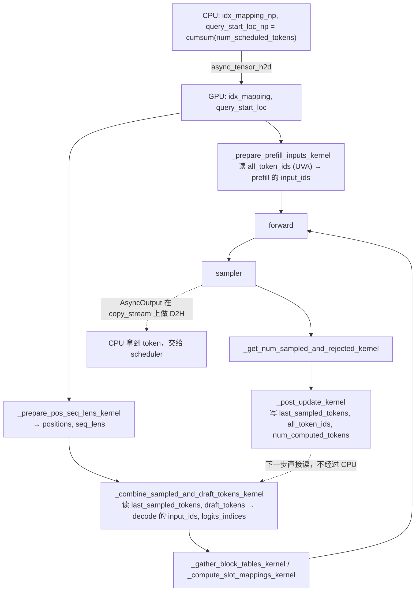

# GPU 上准备输入和处理输出

代码版本：[vLLM `e80b6c6`](https://github.com/vllm-project/vllm/commit/e80b6c642f21fd5b24439825592f5b9ced36add8)。

MRV2 用 Triton kernel 在 GPU 上填 `input_ids`、`positions`、`seq_lens`、`logits_indices`、block table 和 slot mapping。采样之后，请求状态（上一步采样的 token、`num_computed_tokens` 等）也由 kernel 在 GPU 上更新。CPU 只算 `idx_mapping` 和 `query_start_loc` 两个小数组。

有两点要先说清楚：

- `query_start_loc` 不是 kernel 算的。它在 CPU 上用 `np.cumsum` 算好，再用 `async_tensor_h2d` 拷到 GPU（[`model_runner.py` L1441-L1448](https://github.com/vllm-project/vllm/blob/e80b6c642f21fd5b24439825592f5b9ced36add8/vllm/v1/worker/gpu/model_runner.py#L1441-L1448)）。只有开了 adaptive verification，`reallocate_drafts` 才会在 GPU 上重算一遍。
- 代码里没有叫 `prefill_token_ids` 的 tensor。走 UVA 的那张大表是 `req_states.all_token_ids`。

## 输入准备

都在 [`prepare_inputs`](https://github.com/vllm-project/vllm/blob/e80b6c642f21fd5b24439825592f5b9ced36add8/vllm/v1/worker/gpu/model_runner.py#L1367) 和 [`prepare_attn`](https://github.com/vllm-project/vllm/blob/e80b6c642f21fd5b24439825592f5b9ced36add8/vllm/v1/worker/gpu/model_runner.py#L1569) 里调用。

| Kernel | 产出 | 位置 | 调用处 |
|---|---|---|---|
| `_prepare_prefill_inputs_kernel` | prefill 请求的 `input_ids`，以及 `next_prefill_tokens` | [`input_batch.py#L271`](https://github.com/vllm-project/vllm/blob/e80b6c642f21fd5b24439825592f5b9ced36add8/vllm/v1/worker/gpu/input_batch.py#L271) | [`model_runner.py#L1463`](https://github.com/vllm-project/vllm/blob/e80b6c642f21fd5b24439825592f5b9ced36add8/vllm/v1/worker/gpu/model_runner.py#L1463) |
| `_prepare_pos_seq_lens_kernel` | `positions`、`seq_lens`，空出来的 `seq_lens` 补 0 | [`input_batch.py#L348`](https://github.com/vllm-project/vllm/blob/e80b6c642f21fd5b24439825592f5b9ced36add8/vllm/v1/worker/gpu/input_batch.py#L348) | [`model_runner.py#L1474`](https://github.com/vllm-project/vllm/blob/e80b6c642f21fd5b24439825592f5b9ced36add8/vllm/v1/worker/gpu/model_runner.py#L1474) |
| `_combine_sampled_and_draft_tokens_kernel` | decode 请求的 `input_ids`（上一步采样的 token 加 draft token），以及 `logits_indices` | [`input_batch.py#L406`](https://github.com/vllm-project/vllm/blob/e80b6c642f21fd5b24439825592f5b9ced36add8/vllm/v1/worker/gpu/input_batch.py#L406) | [`model_runner.py#L1485`](https://github.com/vllm-project/vllm/blob/e80b6c642f21fd5b24439825592f5b9ced36add8/vllm/v1/worker/gpu/model_runner.py#L1485) |
| `_expand_idx_mapping_kernel` | 有 draft 时，把 `idx_mapping` 按 logits 展开成 `expanded_idx_mapping` | [`input_batch.py#L691`](https://github.com/vllm-project/vllm/blob/e80b6c642f21fd5b24439825592f5b9ced36add8/vllm/v1/worker/gpu/input_batch.py#L691) | [`model_runner.py#L1455`](https://github.com/vllm-project/vllm/blob/e80b6c642f21fd5b24439825592f5b9ced36add8/vllm/v1/worker/gpu/model_runner.py#L1455) |
| `_gather_block_tables_kernel` | 按 `idx_mapping` 从各请求的 slot 里取出这一步的 block table | [`block_table.py#L239`](https://github.com/vllm-project/vllm/blob/e80b6c642f21fd5b24439825592f5b9ced36add8/vllm/v1/worker/gpu/block_table.py#L239) | [`model_runner.py#L1576`](https://github.com/vllm-project/vllm/blob/e80b6c642f21fd5b24439825592f5b9ced36add8/vllm/v1/worker/gpu/model_runner.py#L1576) |
| `_compute_slot_mappings_kernel` | 用 `positions` 和 block table 算每个 token 写进 KV cache 的 slot | [`block_table.py#L279`](https://github.com/vllm-project/vllm/blob/e80b6c642f21fd5b24439825592f5b9ced36add8/vllm/v1/worker/gpu/block_table.py#L279) | [`model_runner.py#L1581`](https://github.com/vllm-project/vllm/blob/e80b6c642f21fd5b24439825592f5b9ced36add8/vllm/v1/worker/gpu/model_runner.py#L1581) |

还有一个只在 decode context parallel（DCP）时才用的 `_dcp_local_seq_lens_kernel`，在 [`cp_utils.py#L37`](https://github.com/vllm-project/vllm/blob/e80b6c642f21fd5b24439825592f5b9ced36add8/vllm/v1/worker/gpu/cp_utils.py#L37)。

## 输出处理

| Kernel | 作用 | 位置 | 调用处 |
|---|---|---|---|
| `_get_num_sampled_and_rejected_kernel` | 每个请求这一步采了几个 token、拒绝了几个 draft。chunked prefill 还没跑完的请求记 0 | [`input_batch.py#L508`](https://github.com/vllm-project/vllm/blob/e80b6c642f21fd5b24439825592f5b9ced36add8/vllm/v1/worker/gpu/input_batch.py#L508) | [`sampler.py#L193`](https://github.com/vllm-project/vllm/blob/e80b6c642f21fd5b24439825592f5b9ced36add8/vllm/v1/worker/gpu/sample/sampler.py#L193)、[`rejection_sampler.py#L455`](https://github.com/vllm-project/vllm/blob/e80b6c642f21fd5b24439825592f5b9ced36add8/vllm/v1/worker/gpu/spec_decode/rejection_sampler.py#L455) |
| `_post_update_kernel` | 在 GPU 上更新请求状态：`last_sampled_tokens`、`total_len`、`all_token_ids`、penalty 用的 `output_bin_counts`、`num_computed_tokens` | [`input_batch.py#L557`](https://github.com/vllm-project/vllm/blob/e80b6c642f21fd5b24439825592f5b9ced36add8/vllm/v1/worker/gpu/input_batch.py#L557) | `postprocess_sampled`，[`model_runner.py#L1692`](https://github.com/vllm-project/vllm/blob/e80b6c642f21fd5b24439825592f5b9ced36add8/vllm/v1/worker/gpu/model_runner.py#L1692) |
| `_post_update_num_computed_tokens_kernel` | pooling 模型不采样，只把 `num_computed_tokens` 加上 `query_len` | [`input_batch.py#L659`](https://github.com/vllm-project/vllm/blob/e80b6c642f21fd5b24439825592f5b9ced36add8/vllm/v1/worker/gpu/input_batch.py#L659) | [`model_runner.py#L2350`](https://github.com/vllm-project/vllm/blob/e80b6c642f21fd5b24439825592f5b9ced36add8/vllm/v1/worker/gpu/model_runner.py#L2350) |

Sampler 自己的 kernel（`gumbel_block_argmax` 等）见 [04-sampler.md](04-sampler.md)。

## 一步的流程



## GPU 知道、CPU 还不知道的值

就是上图里那条虚线。上一步采样出的 token 由 `_post_update_kernel` 直接写进 GPU 上的 `last_sampled_tokens`（[`input_batch.py` L573-L585](https://github.com/vllm-project/vllm/blob/e80b6c642f21fd5b24439825592f5b9ced36add8/vllm/v1/worker/gpu/input_batch.py#L573-L585)）：

```python
req_id = tl.program_id(0)                               # 一个 program 处理 batch 里的一个请求
req_state_idx = tl.load(idx_mapping_ptr + req_id)       # 找到它的固定 slot
if req_state_idx < 0:
    # Filter rows with negative index entries.
    return

total_len = tl.load(total_len_ptr + req_state_idx)
num_sampled = tl.load(num_sampled_ptr + req_id)         # 这一步接受了几个 token（spec decode 可能 >1）
if num_sampled > 0:
    # 最后一个接受的 token，下一步 decode 要用它做 input
    token_id = tl.load(
        sampled_tokens_ptr + req_id * sampled_tokens_stride + num_sampled - 1
    )
    tl.store(last_sampled_tokens_ptr + req_state_idx, token_id)   # 写在 GPU 上，CPU 不参与
    tl.store(total_len_ptr + req_state_idx, total_len + num_sampled)
```

下一步 `_combine_sampled_and_draft_tokens_kernel` 直接读这块 GPU 内存，拼出 decode 的 `input_ids`（[`input_batch.py` L440-L464](https://github.com/vllm-project/vllm/blob/e80b6c642f21fd5b24439825592f5b9ced36add8/vllm/v1/worker/gpu/input_batch.py#L440-L464)）：

```python
seq_len = tl.load(seq_lens_ptr + batch_idx)
prefill_len = tl.load(prefill_len_ptr + req_state_idx)
if seq_len <= prefill_len:
    # Handling prefill tokens. No sampled or draft tokens.
    return                                               # 还在 prefill，input_ids 已由 prefill kernel 填好

# Keep prompt-tail slots intact; only rewrite generated-token slots.
first_logit_seq_pos = seq_len - num_logits
if NUM_NEW_SAMPLED_TOKENS > 0 and first_logit_seq_pos >= prefill_len:
    # Write the last sampled token ID to input_ids.
    # 从 GPU 上的 last_sampled_tokens 读，不需要等 CPU 拿到采样结果
    last_token_id = tl.load(last_sampled_tokens_ptr + req_state_idx)
    tl.store(input_ids_ptr + logits_start, last_token_id)

# Write the draft tokens (if any) to input_ids.
if num_draft_tokens > 0:
    # draft token 也是 GPU 上的 speculator 刚写的，CPU 同样不知道具体值
    mask = block < num_draft_tokens
    draft_tokens = tl.load(
        draft_tokens_ptr + req_state_idx * draft_tokens_stride + block,
        mask=mask,
    )
    tl.store(
        input_ids_ptr + query_end - num_draft_tokens + block,
        draft_tokens,
        mask=mask,
    )
```

开了异步调度后，第 N+1 步准备输入时，第 N 步采样出的 token 可能还没拷回 CPU。scheduler 只知道"这个请求要跑 1 个 token"（有 spec decode 时是 1+k 个），不知道 token 的具体值。具体值由 GPU 自己填，所以 CPU 不用等。

CPU 开销低，是因为这些 kernel 都是每个请求起一个 program（grid 是 `(num_reqs,)`），在 GPU 上做 gather 和写入。CPU 不用在 Python 里逐个请求拼 token。

## UVA 用在哪

最大的一块是 `all_token_ids`，大小为 `[max_num_reqs, max_model_len]`。默认不在 GPU 上分配显存，而是放在 pinned CPU 内存里，GPU 通过 UVA 直接读（[`states.py` L32-L42](https://github.com/vllm-project/vllm/blob/e80b6c642f21fd5b24439825592f5b9ced36add8/vllm/v1/worker/gpu/states.py#L32-L42)）：

```python
# NOTE(woosuk): This tensor can be extremely large (e.g., several GBs)
# depending on the configured max_num_reqs and max_model_len.
# To save GPU memory, we use UVA instead of GPU by default, but
# ngram_gpu benefits from dense device residency because it scans
# active rows repeatedly during proposal.
self.all_token_ids = StagedWriteTensor(
    (self.max_num_reqs, self.max_model_len),
    dtype=torch.int32,
    device=device,
    uva_instead_of_gpu=not use_dense_all_token_ids,   # 默认 True：走 UVA；ngram_gpu 才放显存
)
```

`StagedWriteTensor` 里根据这个开关二选一（[`buffer_utils.py` L154-L162](https://github.com/vllm-project/vllm/blob/e80b6c642f21fd5b24439825592f5b9ced36add8/vllm/v1/worker/gpu/buffer_utils.py#L154-L162)）：

```python
uva_instead_of_gpu = uva_instead_of_gpu and is_uva_available()   # 平台不支持 UVA 就退回显存
if not uva_instead_of_gpu:
    # Create a GPU tensor (default)
    self.gpu = torch.zeros(size, dtype=dtype, device=device)      # 普通显存
else:
    # For a large but not-frequently-accessed tensor, we can use UVA instead of
    # GPU to save GPU memory
    self._uva_buf = UvaBuffer(size, dtype)                        # pinned CPU 内存，self.gpu 是它的 UVA 视图
```

读写它的有两个 kernel：

- `_prepare_prefill_inputs_kernel` 只读这一步要跑的 prompt token（从 `num_computed` 开始的 `query_len` 个），加上几个 lookahead token。
- `_post_update_kernel` 往里写这一步新采到的 token。

两者每一步只碰很少几个元素，所以用 UVA 走 PCIe 读写不会成为瓶颈。整张表却可能有几个 GB，放进显存很浪费。

除此之外，`prompt_len` 和 `prefill_len` 是 `UvaBackedTensor`（[`states.py` L52-L53](https://github.com/vllm-project/vllm/blob/e80b6c642f21fd5b24439825592f5b9ced36add8/vllm/v1/worker/gpu/states.py#L52-L53)），prompt embeds 的指针表也走 UVA（[`prompt_embeds.py` L66-L68](https://github.com/vllm-project/vllm/blob/e80b6c642f21fd5b24439825592f5b9ced36add8/vllm/v1/worker/gpu/model_states/prompt_embeds.py#L66-L68)）。
