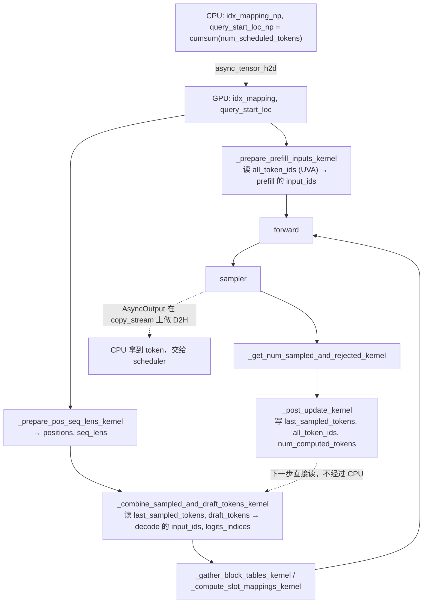
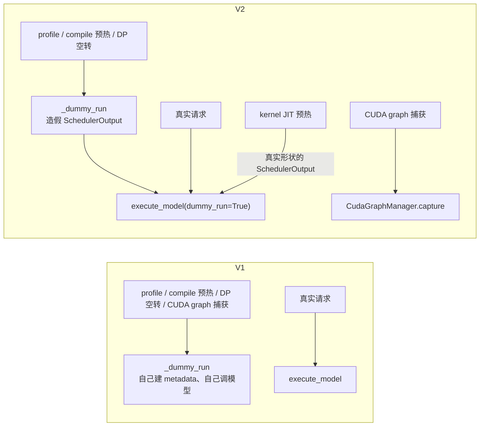
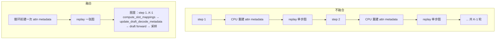

# V2 其他特性

代码版本：[vLLM `e80b6c6`](https://github.com/vllm-project/vllm/commit/e80b6c642f21fd5b24439825592f5b9ced36add8)。

这一篇放前面几篇没讲的 V2 特性：

- GPU 上准备输入和处理输出，以及 UVA
- 模块拆分
- `dummy_run` 不再一个函数干所有事
- `CudaGraphManager` 显式管理 CUDA graph
- 融合多步 draft 解码

## GPU 上准备输入和处理输出

MRV2 用 Triton kernel 在 GPU 上填 `input_ids`、`positions`、`seq_lens`、`logits_indices`、block table 和 slot mapping。采样之后，请求状态（上一步采样的 token、`num_computed_tokens` 等）也由 kernel 在 GPU 上更新。CPU 只算 `idx_mapping` 和 `query_start_loc` 两个小数组。

有两点要先说清楚：

- `query_start_loc` 不是 kernel 算的。它在 CPU 上用 `np.cumsum` 算好，再用 `async_tensor_h2d` 拷到 GPU（[`model_runner.py` L1441-L1448](https://github.com/vllm-project/vllm/blob/e80b6c642f21fd5b24439825592f5b9ced36add8/vllm/v1/worker/gpu/model_runner.py#L1441-L1448)）。只有开了 adaptive verification，`reallocate_drafts` 才会在 GPU 上重算一遍。
- 代码里没有叫 `prefill_token_ids` 的 tensor。走 UVA 的那张大表是 `req_states.all_token_ids`。

### 输入准备

都在 [`prepare_inputs`](https://github.com/vllm-project/vllm/blob/e80b6c642f21fd5b24439825592f5b9ced36add8/vllm/v1/worker/gpu/model_runner.py#L1367) 和 [`prepare_attn`](https://github.com/vllm-project/vllm/blob/e80b6c642f21fd5b24439825592f5b9ced36add8/vllm/v1/worker/gpu/model_runner.py#L1569) 里调用。

| Kernel | 产出 | 位置 | 调用处 |
|---|---|---|---|
| `_prepare_prefill_inputs_kernel` | prefill 请求的 `input_ids`，以及 `next_prefill_tokens` | [`input_batch.py#L271`](https://github.com/vllm-project/vllm/blob/e80b6c642f21fd5b24439825592f5b9ced36add8/vllm/v1/worker/gpu/input_batch.py#L271) | [`model_runner.py#L1463`](https://github.com/vllm-project/vllm/blob/e80b6c642f21fd5b24439825592f5b9ced36add8/vllm/v1/worker/gpu/model_runner.py#L1463) |
| `_prepare_pos_seq_lens_kernel` | `positions`、`seq_lens`，空出来的 `seq_lens` 补 0 | [`input_batch.py#L348`](https://github.com/vllm-project/vllm/blob/e80b6c642f21fd5b24439825592f5b9ced36add8/vllm/v1/worker/gpu/input_batch.py#L348) | [`model_runner.py#L1474`](https://github.com/vllm-project/vllm/blob/e80b6c642f21fd5b24439825592f5b9ced36add8/vllm/v1/worker/gpu/model_runner.py#L1474) |
| `_combine_sampled_and_draft_tokens_kernel` | decode 请求的 `input_ids`（上一步采样的 token 加 draft token），以及 `logits_indices` | [`input_batch.py#L406`](https://github.com/vllm-project/vllm/blob/e80b6c642f21fd5b24439825592f5b9ced36add8/vllm/v1/worker/gpu/input_batch.py#L406) | [`model_runner.py#L1485`](https://github.com/vllm-project/vllm/blob/e80b6c642f21fd5b24439825592f5b9ced36add8/vllm/v1/worker/gpu/model_runner.py#L1485) |
| `_expand_idx_mapping_kernel` | 有 draft 时，把 `idx_mapping` 按 logits 展开成 `expanded_idx_mapping` | [`input_batch.py#L691`](https://github.com/vllm-project/vllm/blob/e80b6c642f21fd5b24439825592f5b9ced36add8/vllm/v1/worker/gpu/input_batch.py#L691) | [`model_runner.py#L1455`](https://github.com/vllm-project/vllm/blob/e80b6c642f21fd5b24439825592f5b9ced36add8/vllm/v1/worker/gpu/model_runner.py#L1455) |
| `_gather_block_tables_kernel` | 按 `idx_mapping` 从各请求的 slot 里取出这一步的 block table | [`block_table.py#L239`](https://github.com/vllm-project/vllm/blob/e80b6c642f21fd5b24439825592f5b9ced36add8/vllm/v1/worker/gpu/block_table.py#L239) | [`model_runner.py#L1576`](https://github.com/vllm-project/vllm/blob/e80b6c642f21fd5b24439825592f5b9ced36add8/vllm/v1/worker/gpu/model_runner.py#L1576) |
| `_compute_slot_mappings_kernel` | 用 `positions` 和 block table 算每个 token 写进 KV cache 的 slot | [`block_table.py#L279`](https://github.com/vllm-project/vllm/blob/e80b6c642f21fd5b24439825592f5b9ced36add8/vllm/v1/worker/gpu/block_table.py#L279) | [`model_runner.py#L1581`](https://github.com/vllm-project/vllm/blob/e80b6c642f21fd5b24439825592f5b9ced36add8/vllm/v1/worker/gpu/model_runner.py#L1581) |

还有一个只在 decode context parallel（DCP）时才用的 `_dcp_local_seq_lens_kernel`，在 [`cp_utils.py#L37`](https://github.com/vllm-project/vllm/blob/e80b6c642f21fd5b24439825592f5b9ced36add8/vllm/v1/worker/gpu/cp_utils.py#L37)。

### 输出处理

| Kernel | 作用 | 位置 | 调用处 |
|---|---|---|---|
| `_get_num_sampled_and_rejected_kernel` | 每个请求这一步采了几个 token、拒绝了几个 draft。chunked prefill 还没跑完的请求记 0 | [`input_batch.py#L508`](https://github.com/vllm-project/vllm/blob/e80b6c642f21fd5b24439825592f5b9ced36add8/vllm/v1/worker/gpu/input_batch.py#L508) | [`sampler.py#L193`](https://github.com/vllm-project/vllm/blob/e80b6c642f21fd5b24439825592f5b9ced36add8/vllm/v1/worker/gpu/sample/sampler.py#L193)、[`rejection_sampler.py#L455`](https://github.com/vllm-project/vllm/blob/e80b6c642f21fd5b24439825592f5b9ced36add8/vllm/v1/worker/gpu/spec_decode/rejection_sampler.py#L455) |
| `_post_update_kernel` | 在 GPU 上更新请求状态：`last_sampled_tokens`、`total_len`、`all_token_ids`、penalty 用的 `output_bin_counts`、`num_computed_tokens` | [`input_batch.py#L557`](https://github.com/vllm-project/vllm/blob/e80b6c642f21fd5b24439825592f5b9ced36add8/vllm/v1/worker/gpu/input_batch.py#L557) | `postprocess_sampled`，[`model_runner.py#L1692`](https://github.com/vllm-project/vllm/blob/e80b6c642f21fd5b24439825592f5b9ced36add8/vllm/v1/worker/gpu/model_runner.py#L1692) |
| `_post_update_num_computed_tokens_kernel` | pooling 模型不采样，只把 `num_computed_tokens` 加上 `query_len` | [`input_batch.py#L659`](https://github.com/vllm-project/vllm/blob/e80b6c642f21fd5b24439825592f5b9ced36add8/vllm/v1/worker/gpu/input_batch.py#L659) | [`model_runner.py#L2350`](https://github.com/vllm-project/vllm/blob/e80b6c642f21fd5b24439825592f5b9ced36add8/vllm/v1/worker/gpu/model_runner.py#L2350) |

Sampler 自己的 kernel（`gumbel_block_argmax` 等）见 [04-sampler.md](04-sampler.md)。

### 一步的流程



### GPU 知道、CPU 还不知道的值

就是上图里那条虚线。上一步采样出的 token 由 `_post_update_kernel` 直接写进 GPU 上的 `last_sampled_tokens`（[`input_batch.py` L573-L585](https://github.com/vllm-project/vllm/blob/e80b6c642f21fd5b24439825592f5b9ced36add8/vllm/v1/worker/gpu/input_batch.py#L573-L585)）：

```python
req_id = tl.program_id(0)                               # 一个 program 处理 batch 里的一个请求
req_state_idx = tl.load(idx_mapping_ptr + req_id)       # 找到它的固定 slot
if req_state_idx < 0:
    # Filter rows with negative index entries.
    return

total_len = tl.load(total_len_ptr + req_state_idx)
num_sampled = tl.load(num_sampled_ptr + req_id)         # 这一步接受了几个 token（spec decode 可能 >1）
if num_sampled > 0:
    # 最后一个接受的 token，下一步 decode 要用它做 input
    token_id = tl.load(
        sampled_tokens_ptr + req_id * sampled_tokens_stride + num_sampled - 1
    )
    tl.store(last_sampled_tokens_ptr + req_state_idx, token_id)   # 写在 GPU 上，CPU 不参与
    tl.store(total_len_ptr + req_state_idx, total_len + num_sampled)
```

下一步 `_combine_sampled_and_draft_tokens_kernel` 直接读这块 GPU 内存，拼出 decode 的 `input_ids`（[`input_batch.py` L440-L464](https://github.com/vllm-project/vllm/blob/e80b6c642f21fd5b24439825592f5b9ced36add8/vllm/v1/worker/gpu/input_batch.py#L440-L464)）：

```python
seq_len = tl.load(seq_lens_ptr + batch_idx)
prefill_len = tl.load(prefill_len_ptr + req_state_idx)
if seq_len <= prefill_len:
    # Handling prefill tokens. No sampled or draft tokens.
    return                                               # 还在 prefill，input_ids 已由 prefill kernel 填好

# Keep prompt-tail slots intact; only rewrite generated-token slots.
first_logit_seq_pos = seq_len - num_logits
if NUM_NEW_SAMPLED_TOKENS > 0 and first_logit_seq_pos >= prefill_len:
    # Write the last sampled token ID to input_ids.
    # 从 GPU 上的 last_sampled_tokens 读，不需要等 CPU 拿到采样结果
    last_token_id = tl.load(last_sampled_tokens_ptr + req_state_idx)
    tl.store(input_ids_ptr + logits_start, last_token_id)

# Write the draft tokens (if any) to input_ids.
if num_draft_tokens > 0:
    # draft token 也是 GPU 上的 speculator 刚写的，CPU 同样不知道具体值
    mask = block < num_draft_tokens
    draft_tokens = tl.load(
        draft_tokens_ptr + req_state_idx * draft_tokens_stride + block,
        mask=mask,
    )
    tl.store(
        input_ids_ptr + query_end - num_draft_tokens + block,
        draft_tokens,
        mask=mask,
    )
```

开了异步调度后，第 N+1 步准备输入时，第 N 步采样出的 token 可能还没拷回 CPU。scheduler 只知道"这个请求要跑 1 个 token"（有 spec decode 时是 1+k 个），不知道 token 的具体值。具体值由 GPU 自己填，所以 CPU 不用等。

CPU 开销低，是因为这些 kernel 都是每个请求起一个 program（grid 是 `(num_reqs,)`），在 GPU 上做 gather 和写入。CPU 不用在 Python 里逐个请求拼 token。

### UVA 用在哪

最大的一块是 `all_token_ids`，大小为 `[max_num_reqs, max_model_len]`。默认不在 GPU 上分配显存，而是放在 pinned CPU 内存里，GPU 通过 UVA 直接读（[`states.py` L32-L42](https://github.com/vllm-project/vllm/blob/e80b6c642f21fd5b24439825592f5b9ced36add8/vllm/v1/worker/gpu/states.py#L32-L42)）：

```python
# NOTE(woosuk): This tensor can be extremely large (e.g., several GBs)
# depending on the configured max_num_reqs and max_model_len.
# To save GPU memory, we use UVA instead of GPU by default, but
# ngram_gpu benefits from dense device residency because it scans
# active rows repeatedly during proposal.
self.all_token_ids = StagedWriteTensor(
    (self.max_num_reqs, self.max_model_len),
    dtype=torch.int32,
    device=device,
    uva_instead_of_gpu=not use_dense_all_token_ids,   # 默认 True：走 UVA；ngram_gpu 才放显存
)
```

`StagedWriteTensor` 里根据这个开关二选一（[`buffer_utils.py` L154-L162](https://github.com/vllm-project/vllm/blob/e80b6c642f21fd5b24439825592f5b9ced36add8/vllm/v1/worker/gpu/buffer_utils.py#L154-L162)）：

```python
uva_instead_of_gpu = uva_instead_of_gpu and is_uva_available()   # 平台不支持 UVA 就退回显存
if not uva_instead_of_gpu:
    # Create a GPU tensor (default)
    self.gpu = torch.zeros(size, dtype=dtype, device=device)      # 普通显存
else:
    # For a large but not-frequently-accessed tensor, we can use UVA instead of
    # GPU to save GPU memory
    self._uva_buf = UvaBuffer(size, dtype)                        # pinned CPU 内存，self.gpu 是它的 UVA 视图
```

读写它的有两个 kernel：

- `_prepare_prefill_inputs_kernel` 只读这一步要跑的 prompt token（从 `num_computed` 开始的 `query_len` 个），加上几个 lookahead token。
- `_post_update_kernel` 往里写这一步新采到的 token。

两者每一步只碰很少几个元素，所以用 UVA 走 PCIe 读写不会成为瓶颈。整张表却可能有几个 GB，放进显存很浪费。

除此之外，`prompt_len` 和 `prefill_len` 是 `UvaBackedTensor`（[`states.py` L52-L53](https://github.com/vllm-project/vllm/blob/e80b6c642f21fd5b24439825592f5b9ced36add8/vllm/v1/worker/gpu/states.py#L52-L53)），prompt embeds 的指针表也走 UVA（[`prompt_embeds.py` L66-L68](https://github.com/vllm-project/vllm/blob/e80b6c642f21fd5b24439825592f5b9ced36add8/vllm/v1/worker/gpu/model_states/prompt_embeds.py#L66-L68)）。

## 模块拆分

V1 几乎所有逻辑都在一个文件 [`gpu_model_runner.py`](https://github.com/vllm-project/vllm/blob/e80b6c642f21fd5b24439825592f5b9ced36add8/vllm/v1/worker/gpu_model_runner.py) 里，有 7221 行。V2 的主文件 [`gpu/model_runner.py`](https://github.com/vllm-project/vllm/blob/e80b6c642f21fd5b24439825592f5b9ced36add8/vllm/v1/worker/gpu/model_runner.py) 只有 2468 行，其余功能拆到了 [`gpu/`](https://github.com/vllm-project/vllm/tree/e80b6c642f21fd5b24439825592f5b9ced36add8/vllm/v1/worker/gpu) 下的子目录：

| 目录或文件 | 拆出去的功能 |
|---|---|
| `sample/` | 采样相关：`penalties.py`、`logit_bias.py`、`min_p.py`、`bad_words.py`、`logprob.py`、`gumbel.py`、`thinking_budget.py`、`watermark.py` |
| `spec_decode/` | 每种 speculator 一个子目录（`eagle`、`mtp`、`ngram`、`dflash` 等），加上 `rejection_sampler.py` |
| `mm/` | 多模态：`rope.py`（mrope）、`encoder_runner.py`、`encoder_cache.py` |
| `model_states/` | 按模型类型拆的 `ModelState`：`default`、`encoder_decoder`、`encoder_only`、`mamba_hybrid`、`prompt_embeds` 等 |
| 平铺的文件 | `input_batch.py`、`block_table.py`、`states.py`、`buffer_utils.py`、`async_utils.py`、`cudagraph_utils.py`、`dp_utils.py`、`pp_utils.py`、`warmup.py`、`structured_outputs.py`、`kv_connector.py`、`pool/` |

## `dummy_run`

`dummy_run` 是"不带真实请求、用假数据跑一次模型"。启动和运行时有好几个场景需要它。

V1 的 [`_dummy_run`](https://github.com/vllm-project/vllm/blob/e80b6c642f21fd5b24439825592f5b9ced36add8/vllm/v1/worker/gpu_model_runner.py#L5476) 有 400 多行。它自己构造 attention metadata、自己调模型，和 `execute_model` 是两套代码。下面这些事都由它一个函数做。V2 把它们分开了：

| 用途 | V1 | V2 |
|---|---|---|
| 初始显存 profile（KV cache 分配前，用最大 batch 跑一次，看 activation 占多少显存） | `profile_run` 调 `_dummy_run(is_profile=True)` | 还是 [`profile_run`](https://github.com/vllm-project/vllm/blob/e80b6c642f21fd5b24439825592f5b9ced36add8/vllm/v1/worker/gpu/model_runner.py#L1002) 调 `_dummy_run`，但 `_dummy_run` 里面调的是 `execute_model` |
| `torch.compile` 预热 | worker 对每个 size 调一次 `_dummy_run`（[`gpu_worker.py#L951`](https://github.com/vllm-project/vllm/blob/e80b6c642f21fd5b24439825592f5b9ced36add8/vllm/v1/worker/gpu_worker.py#L951)） | 同一段 worker 代码（V1 和 V2 共用 worker），同样转到 `execute_model` |
| Kernel JIT 预热 | 没有单独的路径 | 新增 [`warmup_kernels`](https://github.com/vllm-project/vllm/blob/e80b6c642f21fd5b24439825592f5b9ced36add8/vllm/v1/worker/gpu/warmup.py#L218)。它构造真实的 prefill 和 decode `SchedulerOutput`，走 worker 的 `execute_model` 和 `sample_tokens`，**不经过 `dummy_run`** |
| CUDA graph 捕获 | `_warmup_and_capture` 先调几次 `_dummy_run(NONE)` 预热，再调 `_dummy_run(FULL/PIECEWISE)` 捕获（[L6552](https://github.com/vllm-project/vllm/blob/e80b6c642f21fd5b24439825592f5b9ced36add8/vllm/v1/worker/gpu_model_runner.py#L6552)） | 交给 `CudaGraphManager.capture`，**不经过 `dummy_run`**，见下一节 |
| DP 空转（EP+DP 时别的 rank 在跑，这个 rank 没请求也要陪跑一次 forward，否则集合通信会卡住） | `execute_dummy_batch` 调 `_dummy_run`。另外 `execute_model` 里遇到 external launcher 加 DP 的特殊情况，也会调一次 `_dummy_run(1)`（[L3996](https://github.com/vllm-project/vllm/blob/e80b6c642f21fd5b24439825592f5b9ced36add8/vllm/v1/worker/gpu_model_runner.py#L3996)） | `execute_dummy_batch` 调 `_dummy_run`，里面同样走 `execute_model` |



V2 的 [`_dummy_run`](https://github.com/vllm-project/vllm/blob/e80b6c642f21fd5b24439825592f5b9ced36add8/vllm/v1/worker/gpu/model_runner.py#L829) 只做三件事：造一个假的 `SchedulerOutput`，关掉 KV connector，然后调 `execute_model(dummy_run=True)`。

```python
# gpu/model_runner.py L885-L920（节选）
num_scheduled_tokens = {
    f"_dummy_req_{i}": n for i, n in enumerate(num_tokens_per_request)
}
dummy_scheduler_output = SchedulerOutput.make_empty()        # 假的调度结果
dummy_scheduler_output.total_num_scheduled_tokens = num_tokens
dummy_scheduler_output.num_scheduled_tokens = num_scheduled_tokens

# Disable any use of KVConnector for dummy runs.
self.kv_connector.set_disabled(True)                         # dummy run 不做 KV 传输
...
    self.execute_model(                                      # 和真实请求走同一个 execute_model
        dummy_scheduler_output,
        intermediate_tensors=intermediate_tensors,
        dummy_run=True,
        skip_attn_for_dummy_run=skip_attn,
        is_profile=is_profile,
        ...
    )
self.kv_connector.set_disabled(False)
```

`execute_model` 用 `dummy_run` 这个参数跳过所有会改请求状态的操作（[L1743](https://github.com/vllm-project/vllm/blob/e80b6c642f21fd5b24439825592f5b9ced36add8/vllm/v1/worker/gpu/model_runner.py#L1743)）：

```python
if not dummy_run:
    # 只有真实请求才更新状态：结束、释放、新增、更新请求，写 block table
    self.update_pp_decode_requests()
    self.finish_requests(scheduler_output)
    self.free_states(scheduler_output)
    self.add_requests(scheduler_output)
    self.update_requests(scheduler_output)
    self.block_tables.apply_staged_writes()
    ...
# 往下是准备输入、DP 同步、forward，dummy 和真实请求共用这段代码
```

这样 dummy run 和真实请求走的是同一段 forward 代码。V1 里那种"dummy run 能跑通、真实请求出错"（或者反过来）的问题就不会再出现。

## CUDA graph：`CudaGraphManager`

源码里的类名是 `CudaGraphManager`。

**V1 是隐式的。** 模型外面套一层 [`CUDAGraphWrapper`](https://github.com/vllm-project/vllm/blob/e80b6c642f21fd5b24439825592f5b9ced36add8/vllm/compilation/cuda_graph.py#L145)。每次调模型，wrapper 看 forward context 里的 mode 和 batch descriptor，自己判断要不要用图：第一次见到这个形状就捕获，捕获过就 replay。要知道图在哪里、什么时候被捕获，得去 wrapper 里面找。

**V2 是显式的。** [`CudaGraphManager`](https://github.com/vllm-project/vllm/blob/e80b6c642f21fd5b24439825592f5b9ced36add8/vllm/v1/worker/gpu/cudagraph_utils.py#L150) 自己保存一张表：

```python
self.graphs: dict[BatchExecutionDescriptor, torch.cuda.CUDAGraph] = {}
# key 是 batch 形状：cg_mode、num_tokens、num_reqs、uniform_token_count、LoRA 数等
```

对外只有三个方法：

| 方法 | 什么时候调 | 做什么 |
|---|---|---|
| [`capture`](https://github.com/vllm-project/vllm/blob/e80b6c642f21fd5b24439825592f5b9ced36add8/vllm/v1/worker/gpu/cudagraph_utils.py#L424) | 启动时一次 | 把所有要用的形状都捕获好，放进 `self.graphs` |
| [`dispatch`](https://github.com/vllm-project/vllm/blob/e80b6c642f21fd5b24439825592f5b9ced36add8/vllm/v1/worker/gpu/cudagraph_utils.py#L523) | 每一步 | 按这一步的 token 数、请求数、LoRA 数找一张能用的图；找不到返回 `NONE`，这一步 eager 执行 |
| [`run_fullgraph`](https://github.com/vllm-project/vllm/blob/e80b6c642f21fd5b24439825592f5b9ced36add8/vllm/v1/worker/gpu/cudagraph_utils.py#L555) | 每一步（命中 FULL 时） | `self.graphs[desc].replay()` |

`capture` 的核心直接用 PyTorch 的 `torch.cuda.CUDAGraph` 和 `torch.cuda.graph`（[L462-L513](https://github.com/vllm-project/vllm/blob/e80b6c642f21fd5b24439825592f5b9ced36add8/vllm/v1/worker/gpu/cudagraph_utils.py#L462-L513)，节选）：

```python
for desc in descs:                                     # 每个 batch 形状一张图
    # Prepare inputs and get forward function
    forward_fn = create_forward_fn(desc, warmup=True)  # 在图外准备 dummy 输入和 attn metadata

    # Warmup
    forward_fn(CUDAGraphMode.NONE)                     # 先 eager 跑一次预热
    ...
    # Capture with fresh attention state.
    forward_fn = create_forward_fn(desc, warmup=False)
    graph = torch.cuda.CUDAGraph()
    with (
        capture_pool(self.pool, self.vllm_config) as pool,
        torch.cuda.graph(graph, pool, stream=self._capture_stream(desc)),
    ):
        forward_fn(CUDAGraphMode.NONE)                 # 这次 forward 发出的 GPU 操作被录进图
    self.graphs[desc] = graph
```

`CudaGraphManager` 不关心图里录的是什么，调用方传一个 `create_forward_fn` 进来就行：

- 主模型用子类 [`ModelCudaGraphManager`](https://github.com/vllm-project/vllm/blob/e80b6c642f21fd5b24439825592f5b9ced36add8/vllm/v1/worker/gpu/cudagraph_utils.py#L584)。它的 `create_forward_fn` 跑一次模型 forward，并把输出的 hidden states 存进固定地址的 buffer，replay 后从这里取结果。
- speculator 可以传一个"跑 K-1 步 draft"的函数进来，就能把多步 draft 录成一张图，见下一节。

运行时在 [`model_runner.py#L2022`](https://github.com/vllm-project/vllm/blob/e80b6c642f21fd5b24439825592f5b9ced36add8/vllm/v1/worker/gpu/model_runner.py#L2022)：先 `dispatch` 得到描述符；FULL 就 `run_fullgraph`，否则走 piecewise 或 eager。

## 融合多步 draft 解码

**背景。** 假设每一步要生成 K 个 draft token（eagle、MTP 这类自回归 speculator）：

- 第 1 个 draft token 用 target 模型的 hidden states 一次生成。
- 第 2 到第 K 个只能一个接一个生成，每次是"输入 1 个 token、输出 1 个 token"的 decode，一共 K-1 次 draft forward。
- 每跑一次，每个请求的 position 和 seq_len 都加 1，attention 要用的 metadata 也跟着变。

**不融合**（[`_multi_step_decode`](https://github.com/vllm-project/vllm/blob/e80b6c642f21fd5b24439825592f5b9ced36add8/vllm/v1/worker/gpu/spec_decode/target_dependent_ar/speculator.py#L481)）：

```python
for step in range(1, num_speculative_steps):      # Python 循环 K-1 次
    # Rebuild every step when positions advance, or just once
    # on the first step when positions are constant (Gemma4 MTP).
    if not skip_attn and (self.advance_draft_positions or step == 1):
        slot_mappings = self.block_tables.compute_slot_mappings(...)
        ...
        attn_metadata = self._build_uniform_attn_metadata(...)  # 每一步在 CPU 上重建 attn metadata

    self.current_draft_step.fill_(step)

    if batch_desc.cg_mode == CUDAGraphMode.FULL:
        self.decode_cudagraph_manager.run_fullgraph(batch_desc)  # 每一步 replay 一次"单步"的图
    else:
        self._generate_draft(...)
```

K-1 步就是 K-1 次 CPU 重建 metadata，加 K-1 次 graph replay，CPU 和 GPU 来回交替。

**融合**（[`_fused_multi_step_decode`](https://github.com/vllm-project/vllm/blob/e80b6c642f21fd5b24439825592f5b9ced36add8/vllm/v1/worker/gpu/spec_decode/target_dependent_ar/speculator.py#L533)、[`_generate_fused_drafts`](https://github.com/vllm-project/vllm/blob/e80b6c642f21fd5b24439825592f5b9ced36add8/vllm/v1/worker/gpu/spec_decode/target_dependent_ar/speculator.py#L586)）：

```python
# _fused_multi_step_decode
if batch_desc.cg_mode == CUDAGraphMode.FULL:
    ...
    self.decode_cudagraph_manager.run_fullgraph(batch_desc)  # 整个 K-1 步循环只 replay 一次
    return
...
attn_metadata = self._build_uniform_attn_metadata(...)       # eager 时也只在循环前建一次
self._generate_fused_drafts(...)

# _generate_fused_drafts：捕获时，这整个循环被录进同一张图
for step in range(1, num_speculative_steps):
    if attn_metadata is not None and (self.advance_draft_positions or step == 1):
        self.block_tables.compute_slot_mappings(...)          # Triton kernel，原地写 slot mapping
        self._update_draft_decode_metadata(attn_metadata, num_reqs)  # 原地更新 metadata，不重建

    self.current_draft_step.fill_(step)
    self._generate_draft(...)                                 # draft forward、采样、写下一步的输入
```



和不融合比，融合版本有三点不同：

- **metadata 只建一次。** 循环里不再重建。
- **每一步用的 tensor 地址都不变**（positions、seq_lens、slot mapping、metadata 里的 buffer）。每一步只在 GPU 上原地改它们的值，所以整个循环能录进一张图。
- **K-1 次 replay 变成 1 次。**

**`update_draft_decode_metadata` 是干什么的。** 有些 attention backend 会从 `seq_lens` 再算出额外的数据，比如 scheduler metadata、sparse 索引。position 加 1 后这些数据也要跟着更新。所以 backend 需要实现 [`update_draft_decode_metadata`](https://github.com/vllm-project/vllm/blob/e80b6c642f21fd5b24439825592f5b9ced36add8/vllm/v1/attention/backend.py#L750)，在 GPU 上原地刷新这些数据：

```python
def update_draft_decode_metadata(self, metadata: M) -> None:
    """Update draft decode metadata in place.

    Speculators can record this call inside their draft decode CUDA graphs,
    so it runs once at capture and never again in Python. Implementations
    must emit only capture-safe operations and write results into persistent
    tensors that ``metadata`` already references.
    """
    raise NotImplementedError
```

docstring 里那句 "runs once at capture and never again in Python" 是关键：这个函数的 Python 代码只在**捕获时**跑一次，之后每次 replay 只重放它当时发出的 GPU 操作。所以实现时有三个限制：

- 只能用能被 CUDA graph 捕获的操作，比如不能有 `.item()` 这种要等 GPU 结果的 CPU 同步。
- 结果只能写进 `metadata` 已经引用的固定地址 tensor，不能新分配 tensor。
- 不能写"每次运行时在 CPU 上判断一下"的逻辑，因为 replay 时这段 Python 根本不执行。

**什么时候走融合路径。** speculator 初始化时，[`_configure_decode_metadata_update`](https://github.com/vllm-project/vllm/blob/e80b6c642f21fd5b24439825592f5b9ced36add8/vllm/v1/worker/gpu/spec_decode/speculator.py#L308) 检查所有 draft attention group 的 `supports_draft_decode_metadata_update`：

- 全部为 True，才走融合路径。
- 有一个不支持，就退回逐步重建，并打一条 info 日志。
- 目前声明支持的 backend 有 `triton_attn.py`、`mla/sparse_swa.py`、`mla/indexer.py`。
- Gemma4 MTP 这类 draft 每一步 position 不变（`advance_draft_positions=False`），只在 `step == 1` 更新一次，不依赖这个 hook。

一句话概括：不融合是"draft 每走一步，CPU 重建一次 metadata，GPU replay 一次单步图"；融合是"把 K-1 步连同 metadata 的原地更新一起录进一张图，运行时只 replay 一次"。
